# Student Wellness Companion — Architecture Document

**Version:** 1.0  
**Date:** August 2026  
**Status:** Approved for Implementation  
**Source of Truth:** [PROJECT_VISION.md](file:///d:/miniproject/Wellvia/PROJECT_VISION.md)

---

## Table of Contents

1. [Architecture Overview](#1-architecture-overview)
2. [Architectural Style](#2-architectural-style)
3. [High-Level System Architecture](#3-high-level-system-architecture)
4. [Component Architecture](#4-component-architecture)
5. [Student Architecture](#5-student-architecture)
6. [Admin Architecture](#6-admin-architecture)
7. [Authentication and Authorization Architecture](#7-authentication-and-authorization-architecture)
8. [Data Flow Architecture](#8-data-flow-architecture)
9. [Database Architecture](#9-database-architecture)
10. [Analytics Architecture](#10-analytics-architecture)
11. [Wellness Score Architecture](#11-wellness-score-architecture)
12. [Gamification Architecture](#12-gamification-architecture)
13. [Privacy and Security Architecture](#13-privacy-and-security-architecture)
14. [API / Backend Communication](#14-api--backend-communication)
15. [External Dependencies](#15-external-dependencies)
16. [Deployment Architecture](#16-deployment-architecture)
17. [Scalability Considerations](#17-scalability-considerations)
18. [Architectural Decisions](#18-architectural-decisions)
19. [Architectural Assumptions](#19-architectural-assumptions)
20. [Architectural Constraints](#20-architectural-constraints)
21. [Future Architecture Evolution](#21-future-architecture-evolution)
22. [Architecture Summary](#22-architecture-summary)

---

## 1. Architecture Overview

The Student Wellness Companion follows a **modern decoupled three-layer architecture** — separating the application into a rich client-side Single Page Application (SPA), a resilient Flask RESTful Application Layer, and a normalized Data Access Layer.

The primary architectural layers are:

```text
┌─────────────────────────────────────────────────────────────┐
│                   Presentation Layer                        │
│   React 18 Single Page Application · Vite · React Router    │
│   Vanilla CSS3 (Glassmorphism & Dark Theme) · Lucide React  │
│   AI Companion Drawer · Interactive Charts & Visuals        │
├─────────────────────────────────────────────────────────────┤
│                    Application Layer                        │
│   Flask 3.x REST API (/api/*) · Authentication & RBAC       │
│   AI Chatbot Engine (Google GenAI Gemini SDK & Fallback)    │
│   ML Health & Lifestyle Risk Service (Scikit-Learn/Joblib)  │
│   Wellness Scoring Engine · Gamification Engine             │
│   Analytics Processing (Pandas)                             │
├─────────────────────────────────────────────────────────────┤
│                    Data Access Layer                        │
│   PyMySQL · SQLite Fallback · Parameterized Queries         │
│   Isolated User Sessions · Connection Management            │
├─────────────────────────────────────────────────────────────┤
│                    MySQL Database                           │
│   Users · WellnessRecords · WellnessTips · Challenges       │
│   ChallengeProgress · Achievements · UserAchievements      │
└─────────────────────────────────────────────────────────────┘
```

### Why This Architecture Is Appropriate

| Criterion | Rationale |
|-----------|-----------|
| **Modern UX & Interactivity** | Decoupling the frontend into a React SPA enables instantaneous state transitions, smooth modal drawers, and responsive client feedback without page reloads. |
| **Separation of Concerns** | The frontend manages UI rendering, navigation, and client state. Flask acts as a pure REST API handling business logic, ML inference, and AI proxying. |
| **Testability** | Backend logic, security decorators, ML classifiers, and chat fallbacks can be tested via pytest independently of the React frontend. |
| **Resilience & Safety** | The AI chatbot is protected with a multi-model fallback chain and local offline guidance, ensuring students always receive wellness advice even during API outages. |
| **Maintainability** | Adding new habit categories, modifying the ML model, or redesigning charts requires changes only in the targeted module without cascading rewrites. |

---

## 2. Architectural Style

Wellvia utilizes a **decoupled Client-Server Architecture** with a **React 18 SPA Frontend** communicating with a **Flask 3.x RESTful Backend**.

### 2.1 Presentation Layer (React 18 + Vite)

The Presentation Layer is built as a Single Page Application in the `frontend/` directory and compiled via Vite into static assets served by Flask.

**Responsibilities:**

- Client-side routing with `react-router-dom` for both Student and Admin views.
- Dynamic component hierarchy:
  - **Student Dashboard**: Live wellness score, streak counters, body metric summaries, and quick-action log prompts.
  - **Redesigned Progress & Analytics**: 4-section layout with high-level KPI cards, daily wellness bar charts, personalized habit analysis, and actionable improvement recommendations.
  - **AI Wellness Companion**: Drawer component (`ChatbotDrawer.jsx`) communicating with `/api/chat/message`, offering smooth auto-scrolling, rich text rendering, and immediate crisis support banners.
  - **Daily Logging & Habit Forms**: Interactive inputs with client-side bounds checking.
  - **BMI & ML Assessment**: Instant BMI calculation, ML health classification display, and non-clinical advisories.
  - **Admin Management**: Aggregated student analytics, tip curation, challenge creation, and user management.
- Responsive styling using custom CSS design tokens with dark glassmorphic styling, neon emerald accents, and fluid layouts.

**Boundaries:**

- The Presentation Layer does not execute database queries or hold sensitive API keys (e.g. `GEMINI_API_KEY`).
- Communicates exclusively with the backend via JSON over HTTP (`/api/*`).

### 2.2 Application Layer (Flask REST API + AI & ML Engines)

The Application Layer exposes a unified REST API (`/api/*`) and orchestrates business logic, AI interactions, and Machine Learning models.

**Responsibilities:**

- **RESTful Routing (`app/routes/api.py`):** Structured endpoints for Auth (`/api/auth/*`), Student Dashboard & Habits (`/api/student/*`), Admin Operations (`/api/admin/*`), and AI Chat (`/api/chat/*`).
- **AI Wellness Engine (`app/services/chat_service.py`):**
  - Uses the official Google GenAI SDK (`gemini-2.5-flash` / `gemini-3.5-flash`).
  - **Dashboard Context Injection**: Automatically personalizes responses based on the logged-in student's real-time dashboard data (height, weight, BMI, today's sleep quality, hydration, exercise, streak, and score).
  - **Crisis Safety & Intervention**: Evaluates self-harm keywords and immediately triggers emergency helpline resources (988 Lifeline, 741741 Crisis Text Line).
  - **Multi-Model & Local Fallbacks**: Fails over gracefully to backup models or a non-repetitive local assistant (`wellvia_local_assistant`) if offline or rate-limited.
- **Machine Learning Services (`app/services/ml_service.py`):**
  - Pre-trained models predicting Health Status and Lifestyle Risk based on physical metrics and activity logs.
- **Scoring & Gamification:** Rule-based Wellness Score (0–100), streak computation, points accumulation, and badge triggers.
- **Authentication & Security:** Werkzeug password hashing (`scrypt`), secure HTTP-only cookies, and Role-Based Access Control (`@api_login_required`, `@api_student_required`, `@api_admin_required`).

**Boundaries:**

- All sensitive keys (`GEMINI_API_KEY`, `SECRET_KEY`) reside strictly in server environment variables.
- Raw health and physical metrics are never logged or exposed across student sessions.

### 2.3 Data Access Layer

The Data Access Layer manages all interactions with the MySQL database and handles data processing.

**Responsibilities:**

- **CRUD Operations:** Creating, reading, updating, and deleting records across all database tables
- **Query Construction:** Building parameterized SQL queries to prevent injection attacks
- **Connection Management:** Managing database connections via PyMySQL
- **Data Processing:** Using Pandas for aggregation, trend computation, and analytics preparation
- **Data Integrity:** Enforcing foreign key relationships, unique constraints, and data types at the database level

**Entities Managed:**

| Entity | Description |
|--------|-------------|
| Users | Student and administrator accounts |
| WellnessRecords | Daily wellness data (sleep, hydration, exercise, mood, stress, study) |
| WellnessTips | Admin-curated wellness tips |
| Challenges | Admin-created wellness challenges |
| ChallengeProgress | Student participation and completion tracking |
| Achievements | Badge and achievement definitions |
| UserAchievements | Junction table linking students to earned achievements |

**Boundaries:**

- The Data Access Layer does **not** enforce business rules (e.g., point values, score formulas). It stores and retrieves data as directed by the Application Layer.
- Aggregation for analytics may occur in SQL queries or in Pandas, depending on complexity. Simple counts and averages use SQL; multi-dimensional trend analysis uses Pandas.

---

## 3. High-Level System Architecture

The following diagram shows how the major system components connect and communicate:

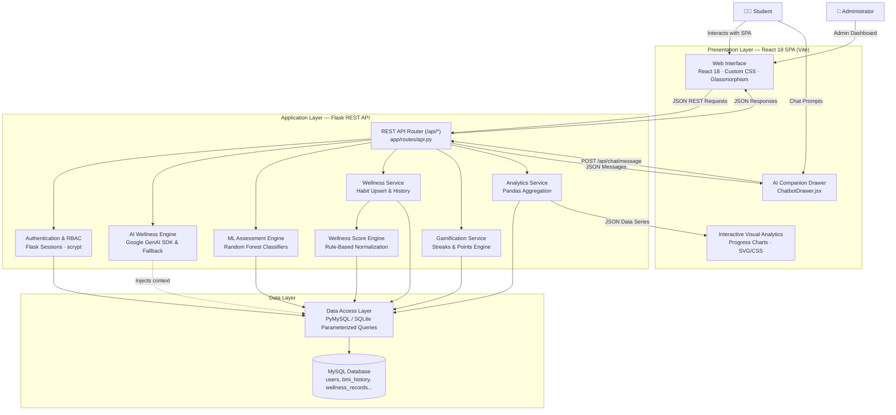

### Diagram Explanation

1. **Students and Administrators** interact with a modern **React 18 Single Page Application (SPA)** that communicates with the backend exclusively via asynchronous JSON REST APIs (`/api/*`).
2. The **REST API Router (`app/routes/api.py`)** receives HTTP requests, verifies authentication state via session cookies, and delegates to the appropriate domain service or AI/ML module.
3. **Authentication & Authorization** enforces Role-Based Access Control (`@api_login_required`, `@api_student_required`, `@api_admin_required`) using secure `scrypt` password hashing.
4. The **AI Wellness Engine (`app/services/chat_service.py`)** interfaces with the official Google GenAI SDK (`gemini-2.5-flash` / `gemini-3.5-flash`), injects real-time student dashboard metrics for personalization, and provides safety crisis interception and local offline fallback.
5. The **Machine Learning Engine (`app/services/ml_service.py`)** loads pre-trained Random Forest models (`model_bmi_rf.joblib`, `model_lifestyle_rf.joblib`) for non-clinical health and lifestyle risk assessments.
6. The **Wellness Score Engine** computes the rule-based composite wellness score (0–100) dynamically.
7. All database persistence uses parameterized SQL queries via **PyMySQL** (or SQLite fallback) preventing SQL injection attacks.
8. Interactive **Progress Charts & Insights** in the frontend render dynamically from JSON data series computed by the Analytics service.

---

## 4. Component Architecture

### 4.1 Frontend Components

```mermaid
flowchart LR
    subgraph Frontend["Frontend Components (React 18 SPA)"]
        AuthUI["Authentication UI<br/>LoginPage · RegisterPage"]
        StudentDash["Student Dashboard<br/>Score · Streaks · Habits · Tips"]
        WellnessForms["Wellness Logging<br/>DailyLogPage.jsx"]
        ChatbotUI["AI Companion Drawer<br/>ChatbotDrawer.jsx"]
        BodyMetricsUI["BMI & ML Health UI<br/>BodyMetricsPage.jsx"]
        TipsUI["Wellness Tips Browser<br/>TipsPage.jsx"]
        ChallengeUI["Challenge Hub<br/>ChallengesPage.jsx"]
        ProgressUI["Progress Analytics (4 Sections)<br/>ProgressPage.jsx"]
        AdminDash["Admin Dashboard<br/>Aggregated Analytics"]
        ContentMgmt["Content Management UI<br/>Tips & Challenges Admin"]
        UserMgmt["User Management UI<br/>Account List & Toggle"]
    end
```

#### Authentication UI

| Attribute | Detail |
|-----------|--------|
| **Purpose** | Enable students and administrators to register, log in, and log out securely |
| **Responsibilities** | Render login and registration views; client-side validation; session state management via `/api/auth/me` |
| **Inputs** | Email/username, password |
| **Outputs** | Authenticated session cookie; redirect to Dashboard |
| **Dependencies** | Authentication Module (`app/routes/api.py`) |

#### Student Dashboard

| Attribute | Detail |
|-----------|--------|
| **Purpose** | Central hub displaying the student's real-time wellness snapshot |
| **Responsibilities** | Display today's wellness score (0–100), habit streaks, body metrics & ML health summary, habit quickview cards (sleep, water, exercise, study), daily rotating tip, and active challenges |
| **Inputs** | JSON payload from `/api/student/dashboard` |
| **Outputs** | Interactive dashboard widgets and quick log triggers |
| **Dependencies** | Backend REST API (`api.py`), Wellness Service, Gamification Service |

#### AI Wellness Companion UI

| Attribute | Detail |
|-----------|--------|
| **Purpose** | Conversational AI companion providing physical and mental wellness guidance |
| **Responsibilities** | Floating trigger button and slide-out chat drawer (`ChatbotDrawer.jsx`); formats markdown text and lists; preserves session chat history; renders crisis intervention badges; provides retry buttons on network timeouts |
| **Inputs** | Student text prompts; conversation history array |
| **Outputs** | Contextually personalized wellness advice referencing student dashboard data |
| **Dependencies** | Chatbot Service (`chat_service.py`), official Google GenAI SDK |

#### Body Metrics & ML Health UI

| Attribute | Detail |
|-----------|--------|
| **Purpose** | Body Mass Index calculator and Machine Learning health assessment interface |
| **Responsibilities** | Input height and weight; trigger real-time WHO BMI calculation; display Random Forest Health Status classification and Lifestyle Risk assessment; display longitudinal history and non-clinical health tips |
| **Inputs** | Height (cm), Weight (kg), Gender |
| **Outputs** | BMI value (2 decimal places), category badge, ML Health Status, ML Lifestyle Risk, and advice |
| **Dependencies** | BMI Calculator (`bmi.py`), ML Service (`ml_service.py`), `/api/student/body-metrics` |

#### Wellness Tracking Forms

| Attribute | Detail |
|-----------|--------|
| **Purpose** | Allow students to log daily wellness data across six categories |
| **Responsibilities** | Input forms for sleep (hours, quality 1–5), hydration (glasses), exercise (type, duration, intensity), mood (1–5), stress (1–5), and study (hours, sessions). Enforce client-side validation bounds |
| **Inputs** | User-entered wellness metrics |
| **Outputs** | Asynchronous POST request to `/api/student/wellness` |
| **Dependencies** | Wellness Service (`wellness.py`), Scoring Service (`scoring.py`) |

#### Wellness Tips UI

| Attribute | Detail |
|-----------|--------|
| **Purpose** | Display curated wellness tips with optional category filtering |
| **Responsibilities** | Filter tips by category (Sleep, Hydration, Exercise, Stress, Study, General) |
| **Inputs** | JSON tip list from `/api/student/tips` |
| **Outputs** | Filtered cards with actionable advice |
| **Dependencies** | Tips Service (`api.py`) |

#### Challenge UI

| Attribute | Detail |
|-----------|--------|
| **Purpose** | Display active challenges and allow students to participate and track progress |
| **Responsibilities** | Show daily/weekly challenges, display completion status, handle completion action with instant point awards |
| **Inputs** | Challenge definitions from `/api/student/challenges` |
| **Outputs** | Challenge completion POST to `/api/student/challenges/<id>/complete` |
| **Dependencies** | Gamification Service (`gamification.py`) |

#### Progress & Analytics UI (Redesigned 4-Section Layout)

| Attribute | Detail |
|-----------|--------|
| **Purpose** | Visualize personal wellness trends and deliver personalized behavioral analysis |
| **Responsibilities** | Structured into four actionable sections: (1) **Wellness Overview** (key metrics, averages, streak), (2) **Daily Wellness Charts** (interactive SVG bar charts for sleep, hydration, exercise, and study over 7, 14, or 30 days), (3) **Your Wellness Analysis** (real-time personalized habit evaluations based on logged data), and (4) **Areas to Improve** (targeted habit recommendations) |
| **Inputs** | JSON analytics payload from `/api/student/progress?days=N` |
| **Outputs** | Interactive bar charts, statistical summary cards, and personalized analytical observations |
| **Dependencies** | Analytics Service (`analytics.py`), Pandas |

#### Admin Dashboard & Management UI

| Attribute | Detail |
|-----------|--------|
| **Purpose** | Provide administrators with campus-wide analytics and content curation tools |
| **Responsibilities** | Display anonymized aggregate wellness statistics; CRUD operations for tips and challenges; student account activation/deactivation toggles |
| **Inputs** | Aggregated data from `/api/admin/*` |
| **Outputs** | Updated tips, challenges, and user account statuses |
| **Dependencies** | Admin Analytics Service (`admin_analytics.py`), REST API |

---

### 4.2 Backend Components

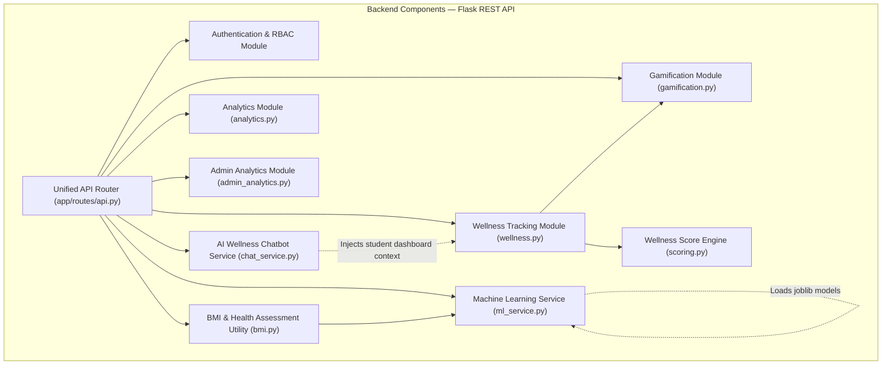

#### Authentication Module

| Attribute | Detail |
|-----------|--------|
| **Purpose** | Manage user identity verification and session lifecycle |
| **Responsibilities** | Handle registration (input validation, duplicate checks, password hashing); handle login (credential verification, session creation); handle logout (session destruction); enforce password complexity rules |
| **Inputs** | Registration data, login credentials, logout requests |
| **Outputs** | Authenticated session, error messages, redirect responses |
| **Dependencies** | User Management Module, Werkzeug (password hashing), Flask session |

#### User Management Module

| Attribute | Detail |
|-----------|--------|
| **Purpose** | Manage user records and profiles |
| **Responsibilities** | Create new user records; retrieve user profiles; update profile information; activate/deactivate accounts; list users for admin views |
| **Inputs** | User data from registration, admin actions |
| **Outputs** | User records, profile data, account status updates |
| **Dependencies** | Data Access Layer (MySQL) |

#### Wellness Tracking Module

| Attribute | Detail |
|-----------|--------|
| **Purpose** | Process and store daily wellness data entries |
| **Responsibilities** | Validate wellness inputs (range checks, data types); create or update daily wellness records; invoke the Wellness Score Engine after each entry; trigger gamification updates (points, streaks) |
| **Inputs** | Wellness form data (sleep, hydration, exercise, mood, stress, study) |
| **Outputs** | Stored wellness record, calculated wellness score, gamification triggers |
| **Dependencies** | Wellness Score Engine, Gamification Module, Data Access Layer |

#### Wellness Tips Module

| Attribute | Detail |
|-----------|--------|
| **Purpose** | Serve curated wellness tips to students |
| **Responsibilities** | Retrieve active tips from the database; support filtering by category; select a daily tip for dashboard rotation |
| **Inputs** | Category filter, request for daily tip |
| **Outputs** | List of tips, single daily tip |
| **Dependencies** | Data Access Layer |

#### Challenge Module

| Attribute | Detail |
|-----------|--------|
| **Purpose** | Manage wellness challenges and student participation |
| **Responsibilities** | Retrieve active challenges; track student participation (start, progress, completion); mark challenges as completed; trigger gamification rewards on completion |
| **Inputs** | Challenge ID, student actions (join, complete) |
| **Outputs** | Challenge list, participation status, completion triggers |
| **Dependencies** | Gamification Module, Data Access Layer |

#### Gamification Module

| Attribute | Detail |
|-----------|--------|
| **Purpose** | Manage all gamification mechanics — points, streaks, badges, and achievements |
| **Responsibilities** | Award points based on the defined point table; calculate and update habit streaks (increment on consecutive days, reset on missed days); check achievement/badge eligibility after each relevant action; record earned achievements in the database |
| **Inputs** | Wellness activity events, challenge completion events |
| **Outputs** | Updated point totals, streak counts, newly earned badges |
| **Dependencies** | Data Access Layer |

#### Analytics Module

| Attribute | Detail |
|-----------|--------|
| **Purpose** | Process wellness data for visualization and insights |
| **Responsibilities** | Aggregate student-specific data for personal charts (weekly, monthly trends); aggregate anonymized data for admin analytics; compute averages, distributions, and trend lines using Pandas; generate simple pattern-based observations from student data |
| **Inputs** | Raw wellness records from the database |
| **Outputs** | Processed chart data (JSON-compatible), summary statistics, textual insights |
| **Dependencies** | Data Access Layer, Pandas |

#### Admin Module

| Attribute | Detail |
|-----------|--------|
| **Purpose** | Coordinate all administrator-specific functionality |
| **Responsibilities** | Serve the admin dashboard; delegate to User Management, Content Management, and Analytics modules; enforce admin-only access on all administrative routes |
| **Inputs** | Admin HTTP requests |
| **Outputs** | Admin dashboard pages, management action responses |
| **Dependencies** | User Management Module, Wellness Tips Module, Challenge Module, Analytics Module |

#### Wellness Score Engine

| Attribute | Detail |
|-----------|--------|
| **Purpose** | Calculate the daily wellness score from logged inputs |
| **Responsibilities** | Normalize raw wellness values to a 0–100 sub-score per component; apply weighted formula; handle missing data gracefully; return a composite score |
| **Inputs** | Daily wellness record (sleep, hydration, exercise, mood, stress, study balance) |
| **Outputs** | Wellness score (integer, 0–100) |
| **Dependencies** | None (pure calculation module) |

---

### 4.3 Database Components

The database consists of six core entities and one junction table. Detailed schema design is documented in `SYSTEM_DESIGN.md`; this section describes entities at the architectural level.

| Entity | Purpose | Key Relationships |
|--------|---------|-------------------|
| **Users** | Stores all user accounts (students and administrators) | One-to-many with WellnessRecords, ChallengeProgress, UserAchievements |
| **WellnessRecords** | Consolidated daily wellness data per student | Many-to-one with Users |
| **WellnessTips** | Admin-curated wellness advice | Standalone (no FK relationships) |
| **Challenges** | Admin-created wellness challenges | One-to-many with ChallengeProgress |
| **ChallengeProgress** | Tracks student participation in challenges | Many-to-one with Users and Challenges |
| **Achievements** | Badge and milestone definitions | One-to-many with UserAchievements |
| **UserAchievements** | Records earned badges per student | Many-to-one with Users and Achievements |

---

## 5. Student Architecture

The student experience follows a clearly defined flow from authentication to personalized interaction:

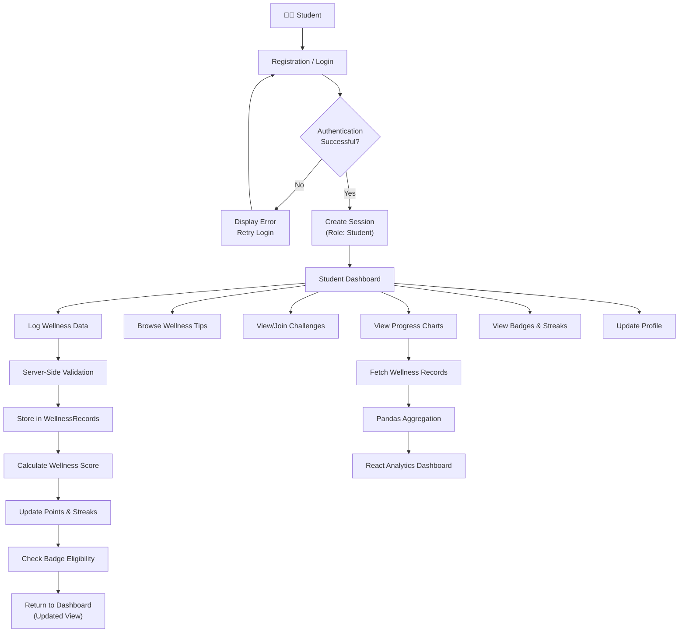

### Complete Student Flow

1. **Entry:** The student navigates to the application URL and reaches the login/registration page.
2. **Authentication:** The student registers (first time) or logs in with existing credentials. Passwords are verified against stored scrypt hashes via `check_password_hash()`. On success, a server-side session is created with the student's user ID and role.
3. **Dashboard:** The student is redirected to their personalized dashboard, which loads today's wellness data, current streaks, wellness score, body metrics, ML health classification, a daily tip, and any active challenges.
4. **Wellness Logging:** The student fills out wellness forms (sleep, hydration, exercise, mood, stress, study). Data is validated server-side, stored in the `WellnessRecords` table, and the wellness score is recalculated.
5. **Gamification Triggers:** After logging, the system awards points, updates streak counts, and checks whether any badge criteria have been met. New badges are recorded in `UserAchievements`.
6. **Analytics:** The student visits the progress page. The backend fetches historical wellness records, processes them through Pandas for aggregation, and sends structured JSON data to the React analytics dashboard for rendering.
7. **Challenges:** The student views active challenges, joins them, and marks them as completed. Completion triggers point awards and potential badge checks.
8. **Logout:** The student logs out, destroying the server-side session.

---

## 6. Admin Architecture

The administrator experience is separated from the student experience at both the route and data access levels.

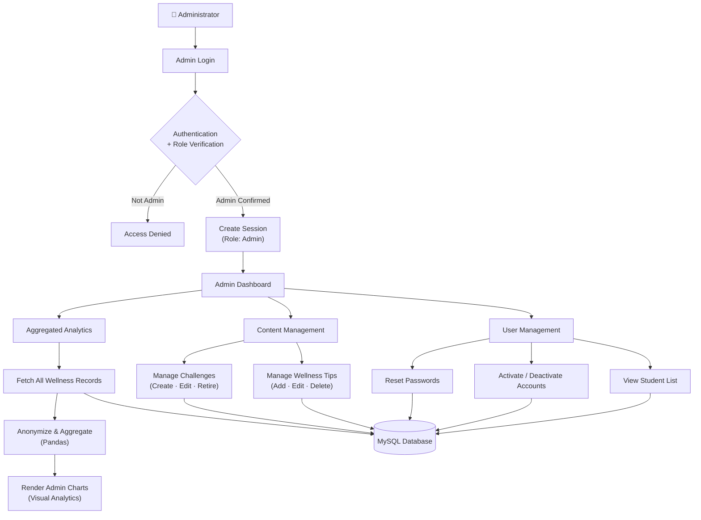

### How Admin Access Is Separated from Student Functionality

| Separation Mechanism | Implementation |
|----------------------|----------------|
| **Role-based routes** | Admin routes are grouped under `/api/admin/*` and protected by decorators checking `@api_admin_required` with `session['role'] == 'admin'`. |
| **Separate dashboards** | Students access `/dashboard`; administrators access `/admin/dashboard`. The two interfaces are distinct React components. |
| **No access to private data** | Admin routes query only aggregated data. The admin analytics module uses SQL `GROUP BY` and `AVG`/`COUNT` operations — individual user IDs are not included in the result set sent to the client. |
| **Account management scope** | Admins can view usernames, emails, registration dates, and account status. They cannot view wellness records, mood logs, or stress levels for individual students. |
| **Pre-created accounts** | Admin accounts are pre-created (seeded during setup), not self-registered. There is no public admin registration route. |

---

## 7. Authentication and Authorization Architecture

### 7.1 Core Concepts

**Authentication** answers the question: *"Who is this user?"*  
It verifies that the person making a request is who they claim to be — through username/email and password verification.

**Authorization** answers the question: *"What is this user allowed to do?"*  
It determines which pages, actions, and data a verified user can access — through role-based access control (RBAC).

### 7.2 Registration Flow

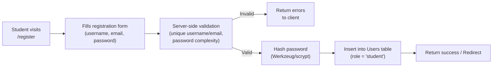

- Passwords are hashed using Werkzeug's `generate_password_hash()` with `scrypt` (`scrypt:32768:8:1`).
- Plaintext passwords are **never** stored or logged.
- Minimum password length and basic complexity rules are enforced.
- Username and email uniqueness is verified before insertion.

### 7.3 Login Flow

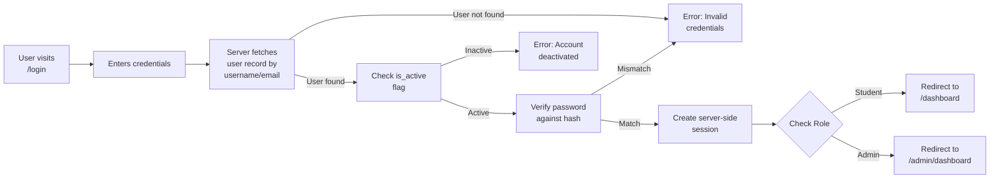

### 7.4 Logout

- The student or admin clicks "Logout."
- The server destroys the session using `session.clear()`.
- The user is redirected to the login page.
- Session cookies are invalidated.

### 7.5 Session Management

| Aspect | Implementation |
|--------|----------------|
| **Session storage** | Server-side using Flask's built-in session mechanism with a secret key |
| **Session data** | User ID, username, role (student/admin) |
| **Cookie flags** | `HttpOnly` (prevent JavaScript access), `Secure` (HTTPS only in production) |
| **Session timeout** | Configurable inactivity timeout (e.g., 30 minutes). **Architectural Assumption.** |
| **Session regeneration** | Session ID is regenerated on login to prevent session fixation |

### 7.6 Role-Based Access Control (RBAC)

The system defines exactly two roles:

| Role | Description | Access Scope |
|------|-------------|--------------|
| **Student** | Primary user who tracks wellness and participates in challenges | All student routes (`/dashboard`, `/wellness`, `/tips`, `/challenges`, `/progress`, `/profile`) |
| **Admin** | Campus wellness coordinator who manages content and views aggregated analytics | All admin routes (`/admin/dashboard`, `/admin/users`, `/admin/tips`, `/admin/challenges`, `/admin/analytics`) |

**Protected Route Implementation:**

Flask route decorators are used to enforce access control:

```text
@login_required          → Ensures the user is authenticated (has an active session)
@student_required        → Ensures the authenticated user has role = 'student'
@admin_required          → Ensures the authenticated user has role = 'admin'
```

**Unauthorized Access Handling:**

- Unauthenticated users attempting to access any protected route are redirected to `/login`.
- Authenticated students attempting to access admin routes receive a 403 Forbidden response or are redirected to their own dashboard.
- Authenticated admins attempting to access student-specific routes receive a 403 Forbidden response.

---

## 8. Data Flow Architecture

### 8.1 Wellness Entry Flow

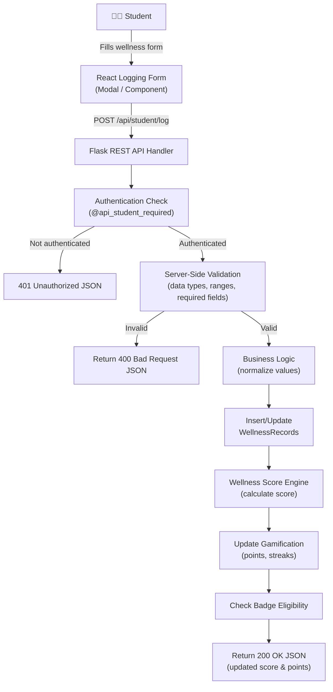

**Detailed flow:**

1. The student fills out the wellness tracking form with today's data.
2. The form submits a POST request to the Flask backend.
3. The route handler checks that the user has an active session.
4. All inputs are validated server-side: data types are checked, numeric values are range-validated (e.g., sleep hours 0–24, mood 1–5, stress 1–5), and required fields are confirmed.
5. Validated data is normalized and written to the `WellnessRecords` table. If a record already exists for today, it is updated rather than duplicated.
6. The Wellness Score Engine calculates the day's score from all available inputs.
7. The Gamification Module awards points, updates streaks, and checks for newly earned badges.
8. The student is redirected back to the dashboard with updated data.

### 8.2 Analytics Data Flow

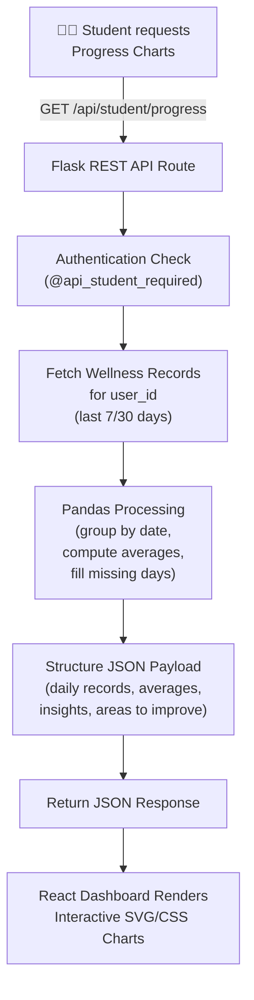

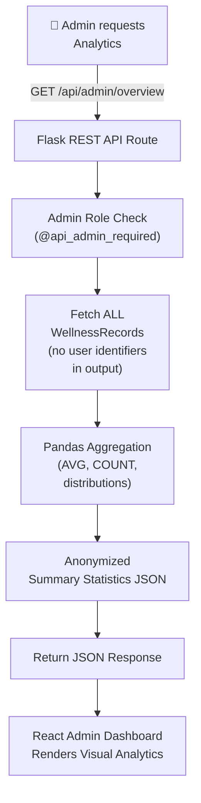

**Key difference:** Student analytics queries include `WHERE user_id = :current_user`. Admin analytics queries use aggregate functions (`AVG`, `COUNT`, `GROUP BY date`) **without** including `user_id` in the `SELECT` or output — ensuring anonymity.

### 8.3 Admin Content Management Flow

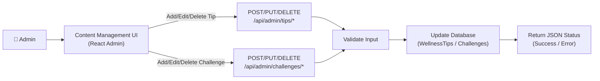

---

## 9. Database Architecture

### 9.1 Entity-Relationship Diagram

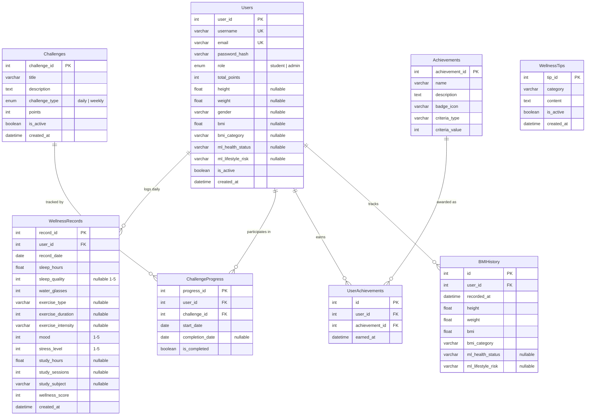

### 9.2 Relationships Summary

| Relationship | Type | Description |
|--------------|------|-------------|
| Users → WellnessRecords | One-to-Many | Each student has multiple daily wellness records. |
| Users → BMIHistory | One-to-Many | Longitudinal BMI calculations and ML classifications recorded per student. |
| Users → ChallengeProgress | One-to-Many | Each student can participate in multiple challenges. |
| Users → UserAchievements | One-to-Many | Each student can earn multiple achievements. |
| Challenges → ChallengeProgress | One-to-Many | Each challenge can be attempted by multiple students. |
| Achievements → UserAchievements | One-to-Many | Each achievement can be earned by multiple students. |
| Users ↔ Challenges | Many-to-Many | Resolved through the ChallengeProgress junction table. |
| Users ↔ Achievements | Many-to-Many | Resolved through the UserAchievements junction table. |

### 9.3 Design Decisions

**Consolidated WellnessRecords Table:**

As documented in the Project Vision, a single `WellnessRecords` table is used instead of separate tables for sleep, hydration, exercise, mood, stress, and study. This decision is based on:

1. **Reduced query complexity** — Dashboard queries retrieve all daily metrics in a single `SELECT` without joins.
2. **Practical scope** — The set of tracked wellness metrics is fixed and known. A normalized design with separate tables would be justified only if custom, user-defined metrics were supported.
3. **Simpler application code** — One insert/update operation per day instead of coordinating writes across multiple tables.

Optional fields (sleep quality, exercise intensity, study subject) are nullable, allowing partial daily entries.

### 9.4 Data Ownership

| Data Type | Owner | Accessible By |
|-----------|-------|---------------|
| Wellness records | Individual student | The student only; aggregated (anonymized) views available to admins |
| Profile information | Individual student | The student; limited admin access (username, email, status) |
| Wellness tips | System (admin-managed) | All users (read); admins (write) |
| Challenges | System (admin-managed) | All students (read/participate); admins (write) |
| Achievement definitions | System | All users (read) |
| Earned achievements | Individual student | The student only |
| Challenge progress | Individual student | The student only |

### 9.5 Indexing Strategy

**Architectural Assumption:** The following indexes are recommended for query performance. Exact indexing will be defined in `SYSTEM_DESIGN.md`.

| Table | Indexed Columns | Rationale |
|-------|-----------------|-----------|
| WellnessRecords | `(user_id, record_date)` | Dashboard queries filter by user and date |
| ChallengeProgress | `(user_id, challenge_id)` | Progress lookups per user per challenge |
| UserAchievements | `(user_id)` | Badge display queries |
| Users | `(username)`, `(email)` | Login lookups |

---

## 10. Analytics Architecture

The analytics system operates at two distinct levels with strict data separation between them.

### 10.1 Student Analytics (Personal)

Student analytics are scoped exclusively to the authenticated student's own data.

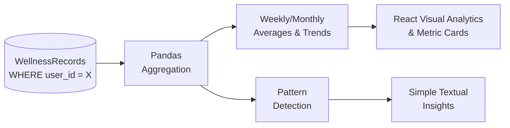

**Available student analytics:**

| Metric | Chart Type | Time Range |
|--------|-----------|------------|
| Sleep hours trend | Bar chart | Weekly / Monthly |
| Hydration progress | Bar chart with target line | Daily / Weekly |
| Exercise trend | Bar chart (frequency & duration) | 4-week rolling |
| Mood trend | Line chart | Weekly / Monthly |
| Stress trend | Line chart | Weekly / Monthly |
| Study hours distribution | Bar chart | Weekly / Monthly |
| Wellness score history | Line chart | Weekly / Monthly |
| Habit completion rate | Donut chart | Monthly |

**Pattern-based observations:**

The system generates simple, data-driven observations by comparing averages across conditions. Examples:

- *"Your average stress level was lower on days when you recorded at least 7 hours of sleep."*
- *"Your mood was generally higher during weeks when you maintained your hydration streak."*

These observations are computed in the Application Layer using straightforward conditional logic (e.g., `avg(stress) WHERE sleep_hours >= 7` vs. `avg(stress) WHERE sleep_hours < 7`). They are **not** clinical assessments or AI predictions.

### 10.2 Admin Analytics (Aggregated)

Admin analytics present anonymized, aggregate data. Individual student identities are **never** included in the query results sent to the admin dashboard.

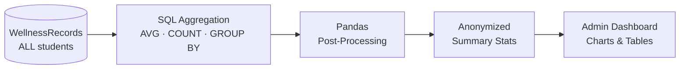

**Available admin analytics:**

| Metric | Computation | Privacy Safeguard |
|--------|-------------|-------------------|
| Average sleep duration | `AVG(sleep_hours) GROUP BY record_date` | No user identifiers in output |
| Average hydration | `AVG(water_glasses) GROUP BY record_date` | No user identifiers in output |
| Mood distribution | `COUNT(*) GROUP BY mood` | Percentage-based distribution |
| Stress distribution | `COUNT(*) GROUP BY stress_level` | Percentage-based distribution |
| Average study hours | `AVG(study_hours) GROUP BY record_date` | No user identifiers in output |
| Challenge participation | `COUNT(DISTINCT user_id) per challenge` | Only counts, not names |
| Habit completion trends | `COUNT(*) GROUP BY record_date` | Aggregate counts only |

### 10.3 Privacy Boundary

The architecture enforces a strict boundary between personal and aggregate analytics:

- **Student analytics queries** always include `WHERE user_id = :current_user_id`.
- **Admin analytics queries** never include `user_id` in the `SELECT` clause or in the data sent to templates.
- Admin SQL queries use aggregate functions (`AVG`, `COUNT`, `SUM`, `GROUP BY`) to ensure individual records cannot be reconstructed.
- **Architectural Assumption:** If the total number of active students is very small (e.g., fewer than 5), aggregate statistics could still be potentially identifying. In such cases, a minimum threshold before displaying aggregated data should be considered in future versions.

---

## 11. Wellness Score Architecture

### 11.1 Purpose and Disclaimer

The wellness score is an **engagement and self-awareness metric** — a numeric indicator that reflects the consistency and balance of self-reported daily habits. It is presented as a motivational tool.

> **Important:** The wellness score is **not** a medical assessment, psychological evaluation, clinical diagnosis, or health rating. Students should consult qualified healthcare professionals for any health concerns. The application clearly communicates this disclaimer in the user interface.

### 11.2 Score Composition

The wellness score is calculated from six components, each contributing a weighted percentage to a total score out of 100:

| Component | Weight | Ideal Range | Scoring Logic |
|-----------|--------|-------------|---------------|
| Hydration | 20% | 8+ glasses | Score increases linearly up to the target; exceeding the target yields full marks |
| Sleep | 20% | 7–9 hours | Scores highest within the ideal range; significantly lower or higher values score less |
| Exercise | 15% | 30+ minutes | Score based on duration logged; any exercise scores above zero |
| Mood | 15% | 4–5 (Happy/Very Happy) | Directly maps from the 1–5 scale |
| Stress | 15% | 1–2 (Low) | Inverse scoring — lower stress yields higher score |
| Study Balance | 15% | 2–6 hours | Scores highest within a balanced range; extremes (0 or 12+) score lower |

### 11.3 Calculation Architecture

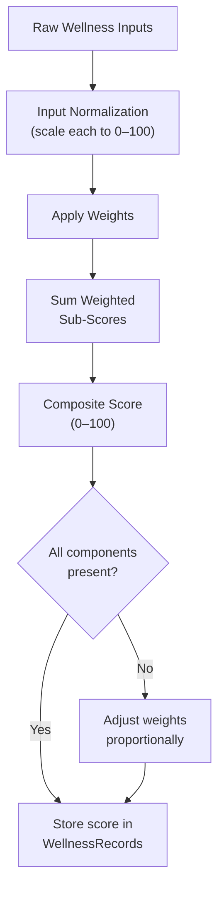

**Input Normalization:**

Each raw value is converted to a 0–100 sub-score using component-specific normalization functions:

```text
Example — Sleep Normalization:
  < 4 hours  →  20/100
  4–5 hours  →  40/100
  5–6 hours  →  60/100
  6–7 hours  →  80/100
  7–9 hours  → 100/100
  9–10 hours →  80/100
  > 10 hours →  60/100

Example — Stress (Inverse) Normalization:
  Stress 1 (Very Low)  → 100/100
  Stress 2 (Low)       →  80/100
  Stress 3 (Moderate)  →  60/100
  Stress 4 (High)      →  40/100
  Stress 5 (Very High) →  20/100
```

**Weighted Calculation:**

```text
Wellness Score = (Hydration_sub × 0.20)
              + (Sleep_sub     × 0.20)
              + (Exercise_sub  × 0.15)
              + (Mood_sub      × 0.15)
              + (Stress_sub    × 0.15)
              + (Study_sub     × 0.15)
```

### 11.4 Missing Data Handling

Students may not log all six categories every day. The architecture handles this as follows:

- If a component is missing, its weight is redistributed proportionally among the components that are present.
- If no components are logged, the wellness score is null/not displayed.
- A minimum of **two components** must be logged for a meaningful score to be calculated. **Architectural Assumption.**

### 11.5 Score Storage

- The calculated wellness score is stored directly in the `wellness_score` column of the `WellnessRecords` table.
- The score is recalculated and updated each time the student logs or modifies wellness data for the current day.
- Historical scores remain stored, enabling trend visualization over time.

---

## 12. Gamification Architecture

The gamification system is designed to sustain engagement through positive reinforcement. All gamification elements are **personal** — there are no public leaderboards or inter-student comparisons.

### 12.1 Gamification Components

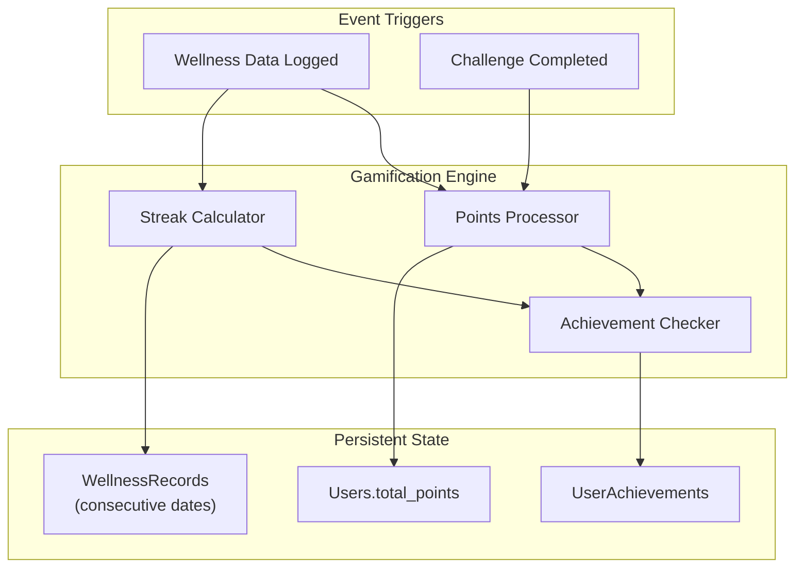

### 12.2 Points System

Points are awarded immediately upon completing an activity:

| Activity | Points |
|----------|--------|
| Log sleep | 10 |
| Log hydration | 10 |
| Log exercise | 15 |
| Record mood | 5 |
| Record stress level | 5 |
| Log study hours | 10 |
| Complete a daily challenge | 20 |
| Complete a weekly challenge | 50 |

Points accumulate in the `Users.total_points` column. **Architectural Assumption:** Point values are configurable during development but stored as application constants, not in the database, for simplicity.

### 12.3 Streak Calculation

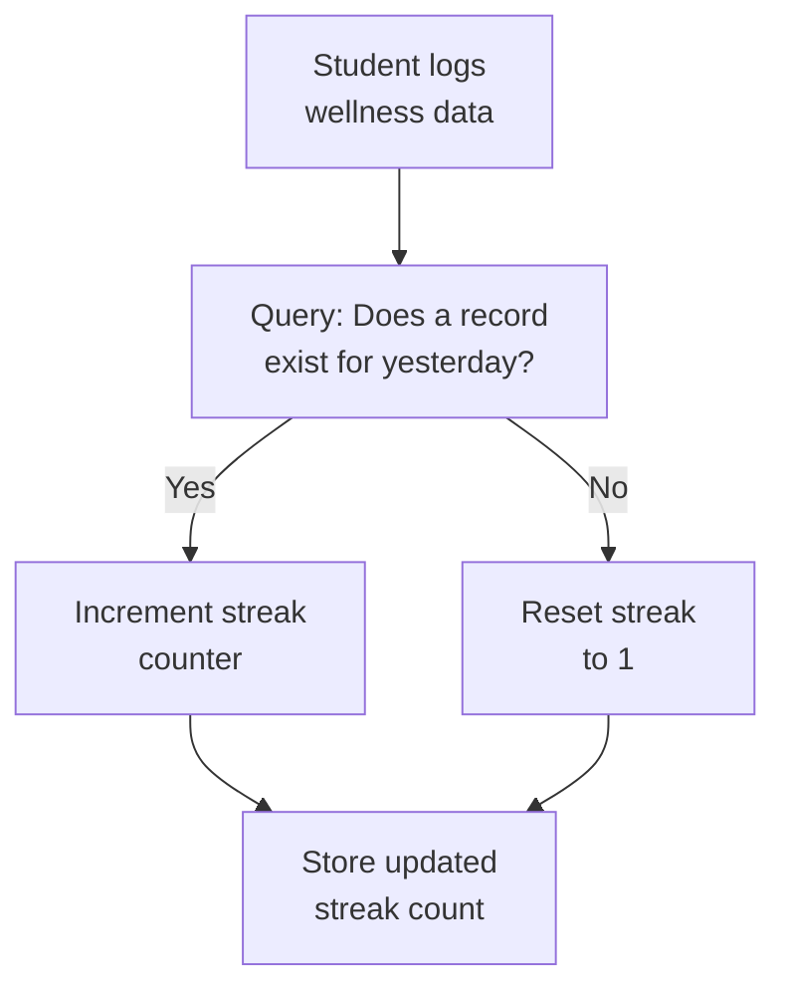

**Implementation approach:**

- Streaks are calculated dynamically by querying `WellnessRecords` for consecutive dates where a specific category was logged.
- **Architectural Assumption:** Streak counts are computed on-the-fly rather than stored in a separate table, keeping the schema simpler. If performance becomes an issue, a cached `UserStreaks` table can be introduced.
- A day is considered "logged" if the corresponding field is not null in the `WellnessRecords` table for that date.

### 12.4 Badges and Achievements

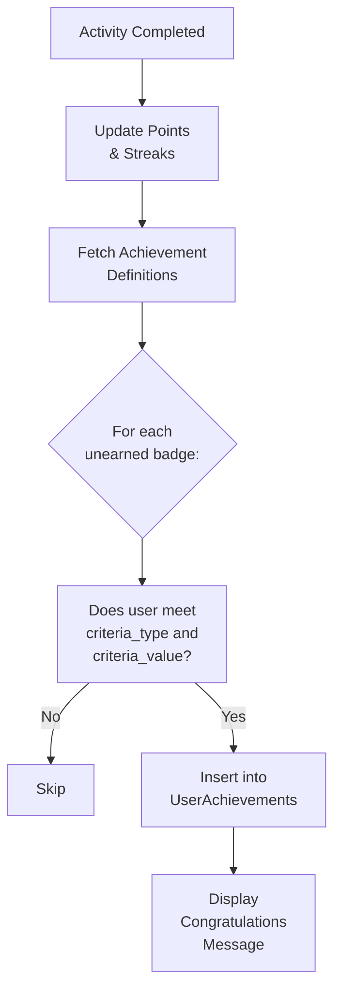

**Badge evaluation:**

- After every points/streak update, the system queries the `Achievements` table for all badges the student has **not yet earned**.
- Each unearned badge's `criteria_type` and `criteria_value` are checked against the student's current data.
- If the criteria are met, a record is inserted into `UserAchievements` with the current timestamp.
- The student sees a notification or badge highlight on their dashboard.

**Example criteria checks:**

| Badge | criteria_type | criteria_value | Check Logic |
|-------|---------------|----------------|-------------|
| 7-Day Streak | `streak` | `7` | Current streak ≥ 7 for any habit |
| Hydration Hero | `hydration_streak` | `7` | 7 consecutive days with water logged |
| Challenge Conqueror | `challenges_completed` | `10` | Total completed challenges ≥ 10 |
| Wellness Explorer | `all_categories_day` | `1` | All 6 categories logged on a single day |

### 12.5 Event-Driven Gamification Flow

```text
Complete Daily Habit
        ↓
Server-Side Validation
        ↓
Store Wellness Record
        ↓
Award Points (+10/15 based on activity)
        ↓
Update Streak Count
        ↓
Check All Unearned Achievements
        ↓
Award New Badges (if criteria met)
        ↓
Update Dashboard (score, points, streaks, badges)
```

---

## 13. Privacy and Security Architecture

### 13.1 Guiding Principle: Least Privilege

The architecture follows the **principle of least privilege** — every user, module, and query is granted only the minimum level of access necessary to perform its function.

| Actor | Minimum Access Required | Denied Access |
|-------|------------------------|---------------|
| Student | Own wellness records, own achievements, shared tips/challenges | Other students' data, admin functions, aggregated analytics |
| Administrator | User list (basic info), tip/challenge management, aggregated analytics | Individual wellness records, student passwords |
| Unauthenticated user | Login page, registration page | All protected routes and data |

### 13.2 Password Security

| Safeguard | Implementation |
|-----------|----------------|
| **Hashing algorithm** | Werkzeug `generate_password_hash()` using scrypt (`scrypt:32768:8:1`) |
| **Plaintext storage** | Never stored, never logged, never transmitted back to the client |
| **Password complexity** | Minimum length and basic complexity rules enforced during registration |
| **Comparison** | `check_password_hash()` performs constant-time comparison to prevent timing attacks |

### 13.3 Role-Based Access Control

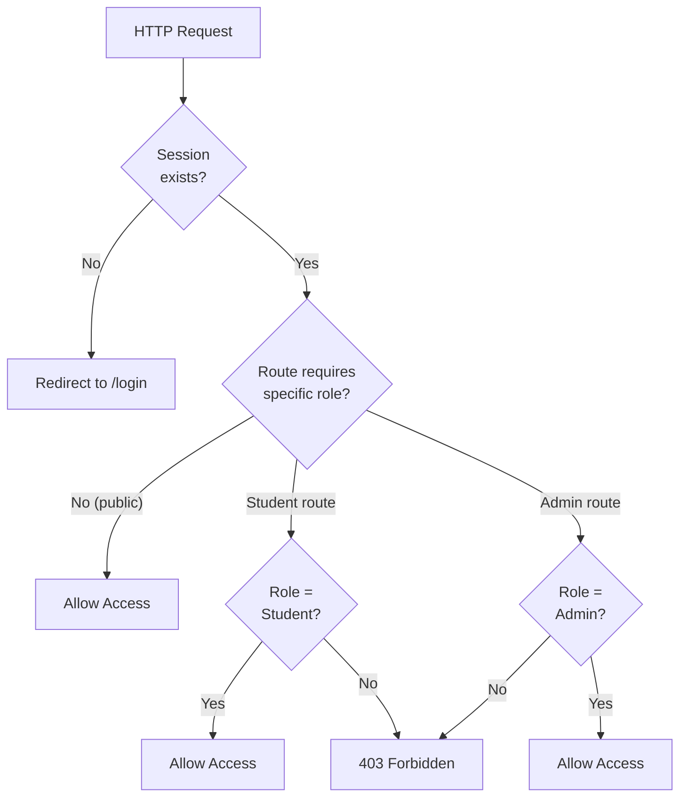

### 13.4 Input Validation and Injection Prevention

| Threat | Mitigation |
|--------|------------|
| **SQL Injection** | All database queries use parameterized statements (`%s` placeholders with PyMySQL). Raw string concatenation in queries is prohibited. |
| **Cross-Site Scripting (XSS)** | React JSX automatically encodes/escapes data before rendering in the DOM, preventing script injection. Backend returns pure JSON (`jsonify`), not dynamically evaluated HTML strings. |
| **Invalid Data** | All form inputs are validated server-side for data type, range, and format before database writes. Client-side validation supplements but does not replace server-side checks. |
| **Mass Assignment** | Only explicitly expected form fields are extracted from request data. Unexpected fields are ignored. |

### 13.5 Session Security

| Safeguard | Detail |
|-----------|--------|
| **Secret key** | Flask's `SECRET_KEY` is set to a strong, random value. Not hardcoded in source code for production. **Architectural Assumption.** |
| **HttpOnly cookies** | Session cookies are marked `HttpOnly` to prevent JavaScript access. |
| **Secure flag** | In production, cookies are marked `Secure` to ensure HTTPS-only transmission. |
| **Inactivity timeout** | Sessions expire after a configurable period of inactivity. |
| **Session fixation prevention** | Session ID is regenerated upon successful login. |

### 13.6 Aggregated Admin Analytics

- Admin analytics queries use SQL aggregate functions (`AVG`, `COUNT`, `SUM`, `GROUP BY`).
- `user_id` is **not** included in `SELECT` clauses of admin analytics queries.
- The admin interface displays distributions, averages, and trends — never individual data points.
- **Architectural Assumption:** Access logging records administrative actions (account changes, content modifications) for accountability.

---

## 14. API / Backend Communication

The Student Wellness Companion uses a **decoupled Single-Page Application (SPA) architecture**. The presentation layer is built with React 18 (bundled via Vite), and all client-server communication occurs via a RESTful JSON API exposed by Flask at `/api/*`.

### 14.1 Route Groups

| Route Group | Base Path | Purpose | Access |
|-------------|-----------|---------|--------|
| **Auth** | `/api/auth/*` | Registration, login, logout, current session check | Public (login/register); Authenticated (logout, me) |
| **Student** | `/api/student/*` | Dashboard data, wellness logging, body metrics/BMI, progress analytics, challenges, tips | Student (`@api_student_required`) |
| **Chat** | `/api/chat/*` | Conversational wellness guidance via Gemini with real-time dashboard context | Student (`@api_student_required`) |
| **Admin** | `/api/admin/*` | Campus overview, anonymized student directory, challenge CRUD, tip CRUD | Admin (`@api_admin_required`) |

### 14.2 Key REST API Endpoints

```text
AUTH
  POST   /api/auth/register                    → Register new student account
  POST   /api/auth/login                       → Authenticate credentials & establish session
  POST   /api/auth/logout                      → Terminate session
  GET    /api/auth/me                          → Retrieve current session user & role

STUDENT
  GET    /api/student/dashboard                → Fetch student's daily stats, streaks, score, active challenges
  POST   /api/student/log                      → Submit daily wellness metrics (sleep, water, exercise, mood, stress, study)
  POST   /api/student/body-metrics             → Update height, weight, gender; triggers BMI & ML risk assessment
  GET    /api/student/progress                 → Fetch 4-section analytics (overview, trends, analysis, areas to improve)
  GET    /api/student/challenges               → List active and completed student challenges
  POST   /api/student/challenges/<id>/join     → Join an active challenge
  POST   /api/student/challenges/<id>/complete → Complete an active challenge and award points
  GET    /api/student/tips                     → Retrieve curated wellness tips

CHAT
  POST   /api/chat/message                     → Send message to Gemini wellness chatbot (with crisis checks & context injection)

ADMIN
  GET    /api/admin/overview                   → Retrieve institutional aggregate metrics and trends
  GET    /api/admin/students                   → List all registered student accounts (status, registration date, points)
  POST   /api/admin/students/<id>/toggle-status→ Activate or deactivate a student account
  GET    /api/admin/challenges                 → List all challenges for admin management
  POST   /api/admin/challenges                 → Create a new challenge
  PUT    /api/admin/challenges/<id>            → Update challenge details
  DELETE /api/admin/challenges/<id>            → Delete a challenge
  GET    /api/admin/tips                       → List all tips for admin management
  POST   /api/admin/tips                       → Create a new wellness tip
  PUT    /api/admin/tips/<id>                  → Update tip content
  DELETE /api/admin/tips/<id>                  → Delete a wellness tip
```

### 14.3 Chart Data Delivery

Interactive charts and visual metrics in the React application consume JSON payloads fetched asynchronously from Flask REST endpoints:

```text
React Component (e.g., ProgressPage)
  → Dispatches authenticated GET /api/student/progress request
  → Flask route authenticates user via session cookie
  → Service queries MySQL database for historical records
  → Pandas aggregates trends, averages, and completion rates
  → Flask returns structured JSON response
  → React parses JSON and renders custom SVG/CSS visualizations, metric cards, and insights
```

---

## 15. External Dependencies

The following external libraries and tools are utilized in the application:

### 15.1 Frontend Dependencies

| Library | Version | Purpose | Source |
|---------|---------|---------|--------|
| **React** | 18.x | Declarative component-based UI framework | npm (`react`, `react-dom`) |
| **Vite** | 5.x | High-performance frontend build tool and dev server | npm (`vite`, `@vitejs/plugin-react`) |
| **React Router** | 6.x | Client-side routing and protected route guards | npm (`react-router-dom`) |
| **Lucide React** | ^1.x / ^0.x | Modern, lightweight UI iconography | npm (`lucide-react`) |
| **Custom Design System** | N/A | Vanilla CSS with design tokens, responsive cards, glassmorphic accents, and SVG charting | Internal (`frontend/src/index.css`) |

### 15.2 Backend Dependencies

| Library | Version | Purpose | Installation |
|---------|---------|---------|-------------|
| **Flask** | 3.x | Lightweight WSGI web framework and REST API host | `pip install flask` |
| **Flask-CORS** | 4.x | Cross-Origin Resource Sharing support for frontend dev server | `pip install flask-cors` |
| **Werkzeug** | 3.x | Secure password hashing (`scrypt:32768:8:1`), request utilities | Included with Flask |
| **PyMySQL** | 1.x | Pure-Python MySQL database client | `pip install pymysql` |
| **Pandas** | 2.x | Data aggregation, trend analysis, and analytics processing | `pip install pandas` |
| **scikit-learn** | 1.x | Machine learning pipeline for Random Forest BMI & lifestyle classifiers | `pip install scikit-learn` |
| **joblib** | 1.x | Efficient deserialization of pre-trained ML model artifacts | `pip install joblib` |
| **google-genai** | 0.x / 1.x | Official Google GenAI SDK for Gemini AI chat (`gemini-2.5-flash`/`gemini-3.5-flash`) | `pip install google-genai` |
| **python-dotenv** | 1.x | Loads environment variables (`.env`) for secrets and configs | `pip install python-dotenv` |

### 15.3 Machine Learning Artifacts

| Model File | Location | Trained Task | Classes |
|------------|----------|--------------|---------|
| `model_bmi_rf.joblib` | `app/ml_artifacts/` | Random Forest BMI classification (500 Person dataset) | Extremely Weak, Weak, Normal, Overweight, Obesity, Extreme Obesity |
| `model_lifestyle_rf.joblib` | `app/ml_artifacts/` | Multi-Factor Lifestyle & Obesity Risk classifier | 7 lifestyle risk assessment classes |

### 15.4 Database

| Technology | Version | Purpose |
|------------|---------|---------|
| **MySQL** | 8.x | Relational database for persistent storage |

### 15.5 Development Tools

| Tool | Purpose |
|------|---------|
| **python-dotenv** | Load environment variables from `.env` file (database credentials, secret key, GEMINI_API_KEY) |
| **Git** | Version control |

---

## 16. Deployment Architecture

### 16.1 Deployment Diagram

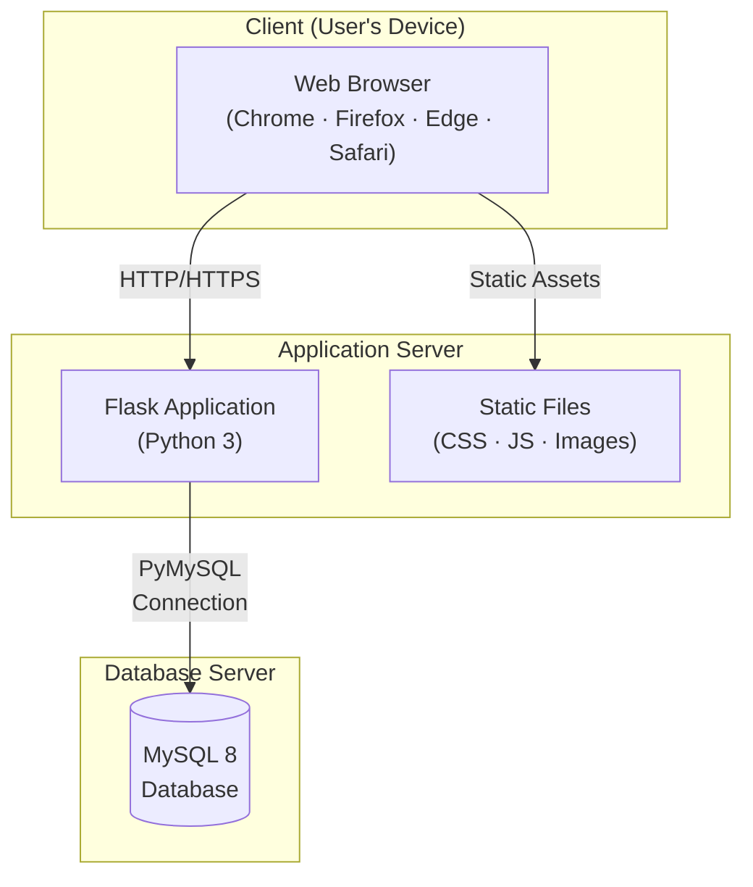

### 16.2 Development Environment

For local development and testing during the academic project:

```text
┌────────────────────────────────────────────┐
│  Developer's Machine                       │
│                                            │
│  ┌──────────────┐     ┌──────────────┐     │
│  │ Flask Dev    │     │ MySQL Server │     │
│  │ Server      │────▶│ (localhost)  │     │
│  │ (port 5000) │     │ (port 3306)  │     │
│  └──────────────┘     └──────────────┘     │
│         ▲                                   │
│         │                                   │
│  ┌──────────────┐                          │
│  │ Web Browser  │                          │
│  │ localhost:5000│                          │
│  └──────────────┘                          │
└────────────────────────────────────────────┘
```

- Flask's built-in development server (`flask run` or `python app.py`) is used during development.
- MySQL runs locally or on a university server accessible to the development machine.
- Debug mode is enabled for development only, providing auto-reload and detailed error pages.

### 16.3 Production Deployment

**Architectural Assumption:** For academic demonstration or limited campus deployment:

```text
┌────────────────────────────────────────────────┐
│  University Server / VPS                       │
│                                                │
│  ┌──────────────┐     ┌──────────────────┐     │
│  │ WSGI Server  │     │ MySQL Server     │     │
│  │ (Gunicorn /  │────▶│ (same host or    │     │
│  │  Waitress)   │     │  university DB)  │     │
│  └──────────────┘     └──────────────────┘     │
│         ▲                                       │
│  ┌──────────────┐                              │
│  │ Reverse Proxy│                              │
│  │ (Nginx)      │                              │
│  │ (Optional)   │                              │
│  └──────────────┘                              │
│         ▲                                       │
└─────────┼──────────────────────────────────────┘
          │ HTTPS
    ┌─────────────┐
    │ User Browser│
    └─────────────┘
```

- A production WSGI server (Gunicorn on Linux, Waitress on Windows) replaces Flask's development server.
- Debug mode is **disabled** in production.
- An optional reverse proxy (Nginx) can handle HTTPS termination, static file serving, and request buffering.
- The `SECRET_KEY` and database credentials are loaded from environment variables, not hardcoded.

---

## 17. Scalability Considerations

The current architecture is designed for a small to moderate number of users (class or department scale). The following considerations outline how the system could scale if needed, clearly separated from what is implemented in the current version.

### 17.1 Current Design (Sufficient for Project Scope)

| Aspect | Current Approach | Expected Capacity |
|--------|-----------------|-------------------|
| **Users** | Single MySQL database, single Flask instance | Up to ~500 concurrent users |
| **Data Volume** | Direct SQL queries, Pandas for analytics | Adequate for thousands of daily records |
| **Static Files** | Served by Flask/Nginx | No CDN required at this scale |

### 17.2 Future Scalability Improvements

| Improvement | Benefit | When to Consider |
|-------------|---------|-----------------|
| **Database Indexing** | Faster queries on large datasets | When query latency exceeds 2–3 seconds |
| **Connection Pooling** | Efficient database connection reuse | When concurrent user count grows significantly |
| **Modular Backend** | Independent scaling of services | When specific modules become bottlenecks |
| **Caching (e.g., Redis)** | Reduce database load for frequently accessed data (tips, challenges, dashboard counts) | When database load becomes a bottleneck |
| **API-Based Frontend** | Decouple frontend from backend; enable mobile apps and SPAs | When mobile app or SPA is developed |
| **Background Jobs** | Offload analytics computation and badge checks to async workers | When analytics processing slows request handling |
| **Horizontal Scaling** | Multiple Flask instances behind a load balancer | When a single server can no longer handle traffic |
| **Cloud Deployment** | Managed database, auto-scaling, CDN for static assets | When deploying for university-wide use |
| **Read Replicas** | Separate read-heavy analytics queries from write operations | When admin analytics queries impact student-facing performance |

> **Note:** These improvements are **not** part of the current implementation. They are documented to show that the layered architecture supports incremental scaling without requiring a complete redesign.

---

## 18. Architectural Decisions

| Decision | Choice | Reason |
|----------|--------|--------|
| **Architecture** | Decoupled Client-Server (SPA + REST API) | Clean separation of frontend UI state and backend business logic; enables responsive, app-like interactions |
| **Backend Framework** | Flask (Python) | Lightweight, minimal boilerplate, clean REST endpoint organization via Blueprints |
| **Database** | MySQL 8.x | Industry-standard relational database with relational integrity and foreign keys |
| **Database Connector** | PyMySQL | Direct parameterized SQL execution without heavyweight ORM overhead |
| **Frontend Framework** | React 18 (Vite) | Component reusability, virtual DOM efficiency, modular state management, modern developer experience |
| **Data Visualization** | Interactive SVG / Custom CSS Charts | Lightweight, zero-runtime overhead, high performance, fully themeable without external canvas bloat |
| **Data Processing** | Pandas | Simplifies aggregation, moving averages, and trend analytics |
| **Password Hashing** | Werkzeug `scrypt` (`scrypt:32768:8:1`) | High memory-hardness and resistance to GPU/ASIC brute-force attacks |
| **AI Integration** | Google GenAI SDK (`gemini-2.5-flash`) | Context-aware student wellness companion with emergency crisis word interception and local fallback |
| **ML Inference** | Pre-trained Random Forest (`joblib` / `scikit-learn`) | Fast, deterministic tabular evaluation for physical health status and lifestyle risk |
| **Session Management** | Flask server-side sessions | Secure HTTP-only cookie-based authentication maintaining role access |
| **Wellness Records** | Consolidated single table | Minimizes join overhead; fixed set of daily holistic health metrics |
| **Gamification Model** | Personal only (no public leaderboards) | Prevents peer pressure while encouraging self-reflection and healthy habits |
| **Admin Data Access** | Aggregated/anonymized only | Guarantees student privacy; enforces principle of least privilege |

---

## 19. Architectural Assumptions

The following assumptions are made where the Project Vision does not provide explicit guidance. They are labeled clearly for review and adjustment.

| # | Assumption | Rationale |
|---|-----------|-----------|
| 1 | Students manually enter all wellness data. No automated data collection. | Explicitly stated in Project Vision; no wearable integration in scope. |
| 2 | All data is self-reported and not independently verified. | The system is a self-awareness tool, not a clinical instrument. |
| 3 | The first version is a web-based application only. | Mobile apps are listed as a future enhancement. |
| 4 | The application does not provide medical diagnosis, clinical advice, or emergency services. | Explicitly stated in Project Vision. |
| 5 | Administrators primarily view aggregated, anonymized data. | Explicitly stated in Project Vision. |
| 6 | MySQL is the primary and only database. | Specified in the technology stack. |
| 7 | Flask is the sole backend framework (no Django, FastAPI, or other frameworks). | Specified in the technology stack. |
| 8 | Admin accounts are pre-created during system setup, not self-registered. | Stated in Project Vision (User Roles table). |
| 9 | Session timeout defaults to 30 minutes of inactivity. | **Architectural Assumption** — reasonable default for a student-facing application. |
| 10 | Streak counts are calculated dynamically from `WellnessRecords` rather than stored in a separate table. | **Architectural Assumption** — simpler schema; adequate for expected data volumes. |
| 11 | Point values are defined as application constants, not stored in the database. | **Architectural Assumption** — simplifies implementation; adjustable in code. |
| 12 | A minimum of two wellness components must be logged for a wellness score to be calculated. | **Architectural Assumption** — prevents misleading scores from single-category entries. |
| 13 | The `SECRET_KEY` and database credentials are managed via environment variables in production. | **Architectural Assumption** — standard security practice for Flask applications. |
| 14 | The application uses PyMySQL with parameterized queries, not an ORM. | Aligns with the learning objectives of a BCA-level project; provides direct SQL experience. |
| 15 | Chart and analytics data is fetched asynchronously via REST API JSON endpoints by React components. | Modern decoupled SPA architecture providing interactive, responsive client-side UI. |

---

## 20. Architectural Constraints

The following constraints are realistic limitations that shape the architecture:

| Constraint | Impact | Mitigation |
|------------|--------|------------|
| **College project development time** (~10–14 weeks) | Limits the number of features that can be implemented and tested thoroughly | Prioritize core features; defer enhancements to future versions |
| **Limited development resources** (small team or solo developer) | No dedicated DBA, DevOps, or QA resources | Use simple deployment; manual testing; keep the architecture straightforward |
| **Self-reported data** | Data accuracy depends entirely on student honesty and consistency | Position the system as a self-awareness tool; include disclaimers |
| **Limited initial user base** (class or department scale) | Insufficient data for statistically significant analytics | Focus on personal analytics; acknowledge the limitation in admin analytics |
| **No wearable integration** in the first version | Students must manually enter all data, increasing friction | Design intuitive, minimal-effort forms; use gamification to encourage logging |
| **No professional medical integration** | The system cannot provide clinical value | Include clear disclaimers; avoid medical language |
| **Single-server deployment** | No horizontal scaling, no high availability | Acceptable for academic demonstration; document scaling path |
| **No real-time notifications** | Students must proactively visit the application | List push notifications as a future enhancement |
| **Browser dependency** | Requires a modern browser and internet connection | Use widely supported web standards; test on major browsers |

---

## 21. Future Architecture Evolution

The following enhancements represent realistic evolution paths for the Student Wellness Companion beyond the current implementation:

### 21.1 Mobile Application

```text
Current:    React SPA → Flask REST API → MySQL
Future:     Native / Hybrid Mobile App → Flask REST API → MySQL
```

- The existing Flask RESTful API (`/api/*`) already provides a mobile-ready interface.
- Build a native (Android/iOS) or hybrid (React Native, Flutter) mobile application consuming the existing endpoints.
- Authentication, scoring, gamification, and ML services require zero backend modifications.

### 21.2 Progressive Web App (PWA)

- Add a service worker and web manifest to enable offline caching and installability.
- Minimal backend changes required; primarily a frontend enhancement.

### 21.3 Wearable Integration

- Introduce a data ingestion module that receives fitness data from smartwatches and fitness bands via vendor APIs.
- The Wellness Tracking Module would accept data from both manual forms and automated sources.
- Requires authentication with third-party fitness platforms (e.g., Google Fit, Apple Health).

### 21.4 Notification Service

- Add a background job scheduler (e.g., Celery with Redis) to send email or push notifications.
- Hydration reminders, sleep goal alerts, streak warnings, challenge deadlines.
- Requires adding a notification preferences module and a message queue.

### 21.5 University-Wide Multi-Tenancy

- Deploy on cloud infrastructure (AWS, GCP, or Azure) with managed databases.
- Add multi-tenancy support for different departments or campuses.
- Implement SSO integration with university authentication systems (LDAP, SAML).

### 21.6 Cloud Infrastructure

```text
Current:    Single Server → Flask REST API → MySQL
Future:     Load Balancer → Multiple Flask Instances → Managed MySQL
            + CDN for React Static Assets
            + Redis for Session/Cache
            + Background Workers for Analytics
```

### 21.7 Architecture Evolution Diagram

```mermaid
flowchart LR
    subgraph Current["Current Architecture (v1)"]
        C1["React 18 SPA"]
        C2["Flask REST API<br/>+ Gemini Chat + ML"]
        C3["MySQL Database"]
    end

    subgraph Near["Near-Term Evolution"]
        N1["PWA Support"]
        N2["Push / Email<br/>Notifications"]
        N3["Wearable Data Sync"]
    end

    subgraph Future["Long-Term Evolution"]
        F1["Mobile Apps<br/>(React Native)"]
        F2["Multi-Tenant Cloud"]
        F3["University SSO (LDAP)"]
    end

    Current --> Near --> Future
```

---

## 22. Architecture Summary

The Student Wellness Companion is built on a **decoupled client-server architecture** using **React 18**, **Flask REST API**, **MySQL 8**, and **scikit-learn Random Forest ML models** with **Google Gemini AI guidance** — a modern, robust, and extensible technology stack that is appropriate for a BCA-level academic project.

### Why This Architecture Works

| Quality | How the Architecture Achieves It |
|---------|----------------------------------|
| **Practical** | Uses widely adopted, well-documented technologies with abundant learning resources. Cleanly separates the modern React frontend from the Python Flask backend via RESTful JSON contracts. |
| **Secure** | Implements robust password hashing (Werkzeug scrypt:32768:8:1), server-side sessions with secure cookie flags, role-based access control with route decorators (`@api_student_required`, `@api_admin_required`), parameterized SQL queries to prevent injection, React auto-escaping to prevent XSS, and crisis safety keyword interception in AI interactions. |
| **Modular** | Each backend module (Auth, Wellness, Gamification, Analytics, Chat, ML Service, Admin) has clearly defined responsibilities and boundaries. Modules can be modified, extended, or replaced independently. |
| **Maintainable** | The decoupled architecture (React Presentation → Flask REST Application → MySQL Data) ensures that UI changes don't break business logic, and database changes don't force UI rewrites. |
| **Scalable** | The existing RESTful architecture already enables mobile clients, external integrations, and cloud deployments without redesigning backend endpoints or business logic. |
| **Appropriate** | The architecture respects the project's scope, constraints, and educational objectives. It provides hands-on experience with modern full-stack development, machine learning tabular inference, and generative AI integration. |

---

*This architecture document is derived from the [PROJECT_VISION.md](file:///d:/miniproject/Wellvia/PROJECT_VISION.md) and serves as the technical blueprint for the Student Wellness Companion. Detailed implementation-level design, including complete database schemas, wireframes, and module specifications, is documented in `SYSTEM_DESIGN.md`.*
