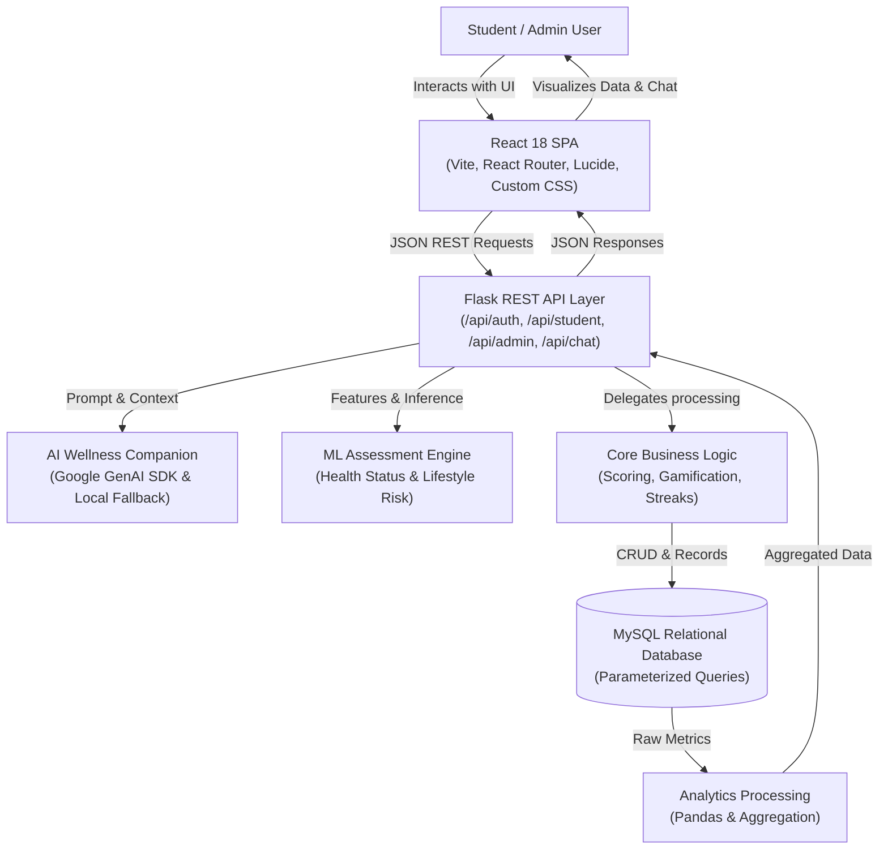
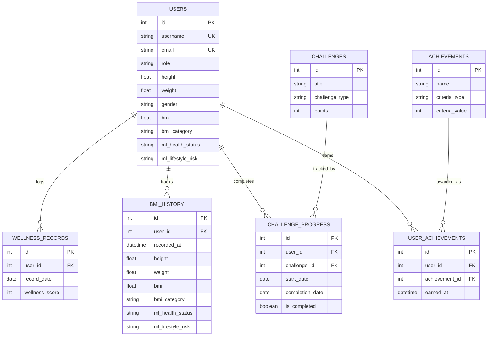
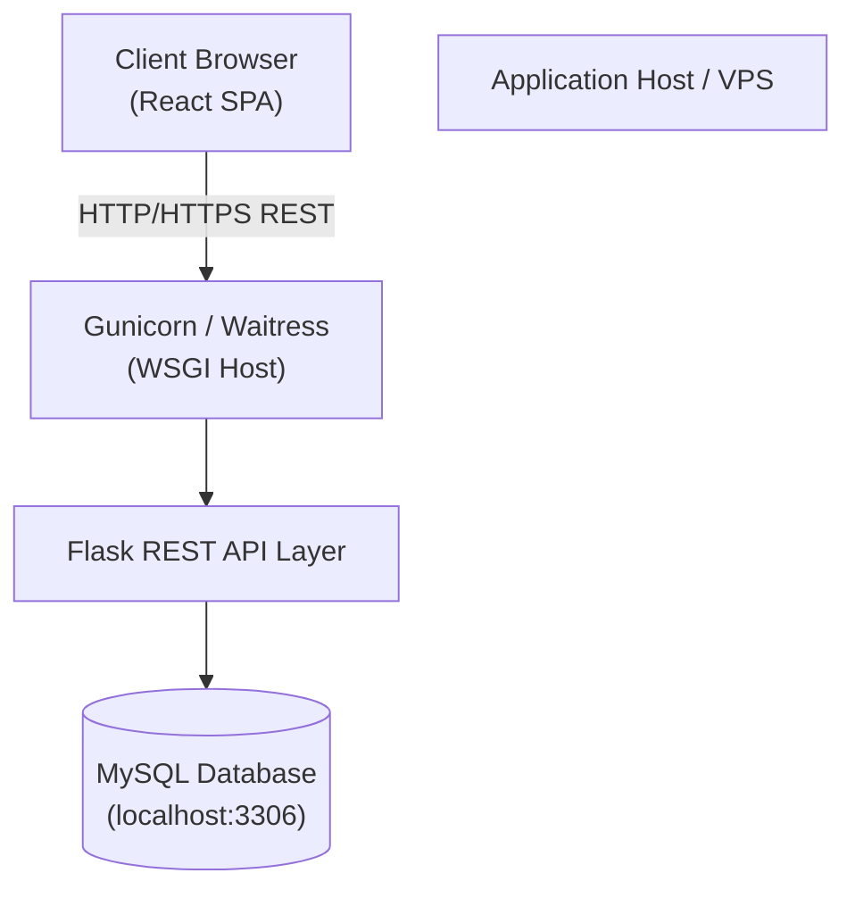

# Student Wellness Companion - System Design Document

**Version:** 1.0
**Source of Truth:** [PROJECT_VISION.md](PROJECT_VISION.md), [ARCHITECTURE.md](ARCHITECTURE.md)

---

## 1. System Overview

The Student Wellness Companion (Wellvia) is a modern web application built on a decoupled architecture. A client-side React 18 Single Page Application communicates via JSON REST APIs with a Python Flask application layer, backed by machine learning models, the Google GenAI Gemini engine, and a MySQL relational database.



---

## 2. Design Goals

The system design prioritizes the following principles:

*   **Modern Interactivity:** Instant SPA page switches and modal transitions via React 18 and Vite.
*   **Contextual AI Personalization:** AI companion dynamically reflects the student's real-time dashboard data (height, weight, BMI, sleep, water, streaks) to give direct, personalized answers.
*   **Failsafe Resilience:** Multi-model fallback chain and local offline guidance ensuring 100% response availability.
*   **Security & Privacy:** Passwords hashed with `scrypt`/`pbkdf2:sha256`, parameterized SQL queries, strict session isolation, and non-disclosure of individual student data in admin reports.
*   **Simplicity & Maintainability:** Clean separation between React presentation components, Flask REST endpoints, and modular services (`chat_service`, `ml_service`, `scoring`, `wellness`, `gamification`).

---

## 3. System Modules

The system is organized into distinct, focused modules.

### Student Modules

1.  **Authentication & Sessions:**
    *   *Purpose:* Handles user registration, login, logout, and session state.
    *   *Processing:* `scrypt` password hashing, HTTP-only session cookies.
2.  **Student Profile & Onboarding:**
    *   *Purpose:* Manages student demographics, height, weight, and onboarding metric flags.
3.  **Dashboard:**
    *   *Purpose:* Real-time hub presenting the daily composite wellness score (0–100), streak counters, body metric cards, and quick daily log access.
4.  **AI Wellness Companion (`chat_service.py` & `ChatbotDrawer.jsx`):**
    *   *Purpose:* Empathetic conversational guidance for student mental and physical health.
    *   *Features:* Dashboard metrics injection, crisis safety intervention (988 / 741741), multi-model fallback, and offline local fallback.
5.  **Machine Learning Health Assessment (`ml_service.py`):**
    *   *Purpose:* Predicts Health Status and Lifestyle Risk using trained scikit-learn models based on physical parameters and activity logs.
6.  **Daily Wellness Logging (Core):**
    *   *Inputs:* Sleep (duration & quality 1–5), Hydration (glasses), Exercise (type, duration, intensity), Mood (1–5), Stress (1–5), Study (hours, sessions).
7.  **Redesigned Progress Analytics (`ProgressPage.jsx`):**
    *   *Section 1 — Wellness Overview:* High-level statistics (averages, streak, total entries).
    *   *Section 2 — Daily Wellness Charts:* Dynamic bar charts for sleep, hydration, exercise, and study across 7, 14, or 30 days.
    *   *Section 3 — Your Wellness Analysis:* Real-time habit pattern evaluations based on saved data.
    *   *Section 4 — Areas to Improve:* Actionable targeted recommendations for low-performing habits.
8.  **Wellness Tips & Challenges:**
    *   *Purpose:* Daily rotating tips and goal-based habit challenges with reward points.
9.  **Gamification Engine:**
    *   *Purpose:* Calculates consecutive habit streaks, awards points, and unlocks milestone achievement badges.

### Admin Modules

10. **Admin Authentication:**
    *   *Purpose:* Secure login for pre-created administrator accounts.
11. **User Management:**
    *   *Purpose:* View student roster and activate/deactivate accounts without viewing private metrics.
12. **Content Management:**
    *   *Purpose:* CRUD tools for wellness tips and campus challenges.
13. **Aggregated Reporting:**
    *   *Purpose:* Campus-wide, anonymized trends and distribution charts.

---

## 4. Detailed User Flows

### Student Registration

```text
Student
→ Submits Registration Form in React UI (Username, Email, Password)
→ API Request: POST /api/auth/register (application/json)
→ Flask Route: Input Validation (Length, format, password complexity)
→ Flask Route: Check Existing User (Is email/username taken?)
→ Utility: Password Hashing (Werkzeug scrypt:32768:8:1)
→ Database: Insert into users (role='student', total_points=0, is_active=1)
→ Flask Route: Return 201 Created JSON
→ React UI: Displays success notification, transitions to login
```

### Student Login

```text
Student
→ Submits Login Form in React UI
→ API Request: POST /api/auth/login (application/json)
→ Flask Route: Validate Credentials (Email exists?)
→ Utility: Verify Password (check_password_hash with scrypt)
→ Flask Route: Create Session (Store user_id, role in signed cookie)
→ Flask Route: Return 200 OK JSON with user profile
→ React UI: Updates AuthContext state and navigates to /dashboard
```

### Daily Wellness Entry

```text
Student
→ Submits Wellness Data via React Modal / Form
→ API Request: POST /api/student/log (application/json)
→ Flask Route: Validate Input (@api_student_required, ranges, numeric checks)
→ Service: Check if record exists for today (uk_user_record_date)
→ Database: Insert or Update wellness_records
→ Service: Calculate/Update Wellness Score (0-100)
→ Gamification Service: Update Streaks, Award Points
→ Gamification Service: Check Achievements (Award badge if eligible)
→ Flask Route: Return 200 OK JSON with updated wellness score & points
→ React UI: Refreshes Dashboard stats & active streak
```

### Challenge Completion

```text
Student
→ Clicks "Complete" on active challenge card
→ API Request: POST /api/student/challenges/<id>/complete
→ Service: Validate challenge exists and belongs to user
→ Database: Update challenge_progress (completion_date = CURRENT_DATE, is_completed = 1)
→ Gamification Service: Award points configured for the challenge
→ Gamification Service: Check achievement eligibility
→ Flask Route: Return 200 OK JSON with earned points
→ React UI: Updates points and marks challenge as completed
```

### Admin Content Management (Tips)

```text
Admin
→ Submits New Tip via Admin React Modal
→ API Request: POST /api/admin/tips (application/json)
→ Flask Route: Verify session role == 'admin' (@api_admin_required)
→ Flask Route: Validate input (category, content)
→ Database: Insert into wellness_tips (category, content, is_active=1)
→ Flask Route: Return 201 Created JSON
→ React UI: Updates tips directory and displays confirmation
```

---

## 5. Database Design

The database uses MySQL. The schema is normalized appropriately for the project scope, utilizing a consolidated `wellness_records` table to simplify daily tracking.

### Users Table
*Purpose:* Stores authentication, role, physical profile, and ML assessment attributes.
| Column | Type | Key | Null | Description |
| :--- | :--- | :--- | :--- | :--- |
| `id` | INT | PK | No | Auto-incrementing ID |
| `username` | VARCHAR(50) | UNI | No | Unique username |
| `email` | VARCHAR(120) | UNI | No | Unique email address |
| `password_hash` | VARCHAR(255) | | No | Werkzeug `scrypt:32768:8:1` hashed password |
| `role` | ENUM | | No | 'student' or 'admin' (default 'student') |
| `total_points` | INT | | No | Default 0 |
| `height` | FLOAT | | Yes | Height in cm |
| `weight` | FLOAT | | Yes | Weight in kg |
| `gender` | VARCHAR(20) | | Yes | Gender ('Female', 'Male', etc.) |
| `bmi` | FLOAT | | Yes | Calculated Body Mass Index |
| `bmi_category` | VARCHAR(50) | | Yes | Standard BMI category |
| `ml_health_status`| VARCHAR(50) | | Yes | Random Forest predicted health status |
| `ml_lifestyle_risk`| VARCHAR(50) | | Yes | Random Forest predicted lifestyle risk |
| `is_active` | BOOLEAN | | No | Default True (for soft deletes) |
| `created_at` | DATETIME | | No | Account creation timestamp |

### BMIHistory Table
*Purpose:* Longitudinal history of physical measurements, BMI calculations, and ML assessment results.
| Column | Type | Key | Null | Description |
| :--- | :--- | :--- | :--- | :--- |
| `id` | INT | PK | No | Auto-incrementing ID |
| `user_id` | INT | FK | No | Refers to Users.id (ON DELETE CASCADE) |
| `recorded_at` | DATETIME | | No | Timestamp of measurement entry |
| `height` | FLOAT | | No | Height in cm |
| `weight` | FLOAT | | No | Weight in kg |
| `bmi` | FLOAT | | No | Body Mass Index |
| `bmi_category` | VARCHAR(50) | | No | Standard BMI category |
| `ml_health_status`| VARCHAR(50) | | Yes | Random Forest predicted health status |
| `ml_lifestyle_risk`| VARCHAR(50) | | Yes | Random Forest predicted lifestyle risk |

### WellnessRecords Table
*Purpose:* Consolidated daily metrics per user.
| Column | Type | Key | Null | Description |
| :--- | :--- | :--- | :--- | :--- |
| `id` | INT | PK | No | Auto-incrementing ID |
| `user_id` | INT | FK | No | Refers to Users.id |
| `record_date` | DATE | | No | Date of the entry |
| `sleep_hours` | FLOAT | | Yes | Hours slept |
| `sleep_quality` | INT | | Yes | Scale 1-5 |
| `water_glasses` | INT | | Yes | Glasses of water |
| `exercise_type` | VARCHAR(50) | | Yes | e.g., 'Running', 'Yoga' |
| `exercise_duration`| INT | | Yes | Minutes |
| `exercise_intensity`| VARCHAR(20) | | Yes | 'Light', 'Moderate', 'Vigorous' |
| `mood` | INT | | Yes | Scale 1-5 |
| `stress_level` | INT | | Yes | Scale 1-5 |
| `study_hours` | FLOAT | | Yes | Hours studied |
| `study_sessions` | INT | | Yes | Number of sessions |
| `study_subject` | VARCHAR(100)| | Yes | Optional tag |
| `wellness_score` | INT | | Yes | Calculated score (0-100) |

*Constraint:* `UNIQUE(user_id, record_date)` to ensure one record per day per user.

### WellnessTips Table
*Purpose:* Admin-curated tips.
| Column | Type | Key | Null | Description |
| :--- | :--- | :--- | :--- | :--- |
| `id` | INT | PK | No | Auto-incrementing ID |
| `category` | VARCHAR(50) | | No | e.g., 'Sleep', 'Hydration' |
| `content` | TEXT | | No | Tip text |
| `is_active` | BOOLEAN | | No | Default True |

### Challenges Table
*Purpose:* Admin-created challenges.
| Column | Type | Key | Null | Description |
| :--- | :--- | :--- | :--- | :--- |
| `id` | INT | PK | No | Auto-incrementing ID |
| `title` | VARCHAR(100) | | No | Short title |
| `description` | TEXT | | No | Details |
| `challenge_type` | ENUM | | No | 'daily' or 'weekly' |
| `points` | INT | | No | Reward points |
| `is_active` | BOOLEAN | | No | Default True |

### ChallengeProgress Table
*Purpose:* Tracks student participation, join date, and completion status.
| Column | Type | Key | Null | Description |
| :--- | :--- | :--- | :--- | :--- |
| `id` | INT | PK | No | Auto-incrementing ID |
| `user_id` | INT | FK | No | Refers to Users.id (ON DELETE CASCADE) |
| `challenge_id` | INT | FK | No | Refers to Challenges.id (ON DELETE CASCADE) |
| `start_date` | DATE | | No | Date challenge was joined |
| `completion_date`| DATE | | Yes | Date completed (NULL if active) |
| `is_completed` | BOOLEAN | | No | Default False (1 if completed) |

### Achievements Table
*Purpose:* Badge definitions.
| Column | Type | Key | Null | Description |
| :--- | :--- | :--- | :--- | :--- |
| `id` | INT | PK | No | Auto-incrementing ID |
| `name` | VARCHAR(100) | | No | e.g., '7-Day Streak' |
| `description` | TEXT | | No | Criteria description |
| `badge_icon` | VARCHAR(50) | | Yes | Lucide/CSS icon descriptor |
| `criteria_type`| VARCHAR(50) | | No | e.g., 'streak', 'points' |
| `criteria_value`| INT | | No | Target value |

### UserAchievements Table
*Purpose:* Junction table for awarded badges.
| Column | Type | Key | Null | Description |
| :--- | :--- | :--- | :--- | :--- |
| `id` | INT | PK | No | Auto-incrementing ID |
| `user_id` | INT | FK | No | Refers to Users.id |
| `achievement_id`| INT | FK | No | Refers to Achievements.id |
| `earned_at` | DATETIME | | No | Timestamp |

---

## 6. Entity Relationships



---

## 7. Database Normalization

The database schema is designed following standard normalization principles to balance data integrity and query simplicity for a BCA-level project.

*   **First Normal Form (1NF):** All tables have a primary key, and columns contain atomic values (e.g., exercise duration is a single integer, not a comma-separated list).
*   **Second Normal Form (2NF):** All tables are in 1NF, and all non-key attributes are fully functionally dependent on the primary key. Junction tables (`UserAchievements`, `ChallengeProgress`) use their own surrogate primary keys to ensure this.
*   **Third Normal Form (3NF):** No transitive dependencies exist. For instance, the definition of an achievement (name, icon) is kept in the `Achievements` table, and the `UserAchievements` table only stores the ID references, preventing duplicate data and update anomalies if an achievement name changes.

*Pragmatic Choice:* We use a consolidated `WellnessRecords` table (wide table format) rather than fully normalizing each metric (e.g., separate `SleepRecords`, `HydrationRecords` tables). This avoids complex joins on the dashboard, significantly simplifying backend logic and query performance for daily tracking.

---

## 8. System Architecture & Directory Design

The project employs a decoupled architecture consisting of a React 18 Single-Page Application (SPA) frontend and a Python Flask REST API backend.

```text
Wellvia/
│
├── frontend/                     # React 18 Single-Page Application (Vite)
│   ├── index.html
│   ├── package.json
│   ├── vite.config.js
│   └── src/
│       ├── App.jsx               # Application routing and context providers
│       ├── main.jsx              # Application bootstrap
│       ├── index.css             # Unified CSS design system & variables
│       ├── context/              # AuthContext & global state
│       ├── components/           # Reusable UI components (ChatbotDrawer, Modals, Navbar...)
│       └── pages/                # Page views (Dashboard, Progress, Challenges, Admin...)
│
├── app/                          # Flask Application Layer
│   ├── __init__.py               # Flask app factory, CORS, DB & route registration
│   ├── db.py                     # Database connection helper with PyMySQL
│   ├── ml_artifacts/             # Pre-trained Random Forest ML models
│   │   ├── model_bmi_rf.joblib
│   │   └── model_lifestyle_rf.joblib
│   ├── routes/
│   │   ├── __init__.py
│   │   └── api.py                # Consolidated REST API endpoints (/api/*)
│   ├── services/                 # Modular business logic
│   │   ├── chat_service.py       # Google GenAI Gemini engine & local fallback
│   │   ├── ml_service.py         # ML health status & lifestyle risk prediction
│   │   ├── scoring.py            # Composite wellness score calculation
│   │   ├── gamification.py       # Streaks, points, and achievement evaluation
│   │   ├── analytics.py          # Student progress data aggregation (Pandas)
│   │   └── admin_analytics.py    # Anonymized campus reporting
│   └── utils/
│       ├── bmi.py                # BMI calculation & standard categorization
│       └── decorators.py         # @api_login_required, @api_student_required, @api_admin_required
│
├── tests/                        # Automated test suite (74 pytest test cases)
├── schema.sql                    # MySQL 8.0+ DDL schema
├── init_db.py                    # Database schema and seed initialization
├── requirements.txt              # Backend Python dependencies
├── run.py                        # Backend application entry point
└── .env                          # Local environment secrets and database credentials
```

---

## 9. Backend Layer Design

The backend is strictly divided into layers to enforce separation of concerns:

*   **REST Controllers (`app/routes/api.py`):** Responsible *only* for receiving HTTP requests, validating session cookies (`@api_student_required`, `@api_admin_required`), extracting JSON request payloads, calling the appropriate Service, and returning structured JSON responses with appropriate HTTP status codes (`200`, `201`, `400`, `401`, `403`, `404`, `500`).
*   **Services (`app/services/`):** Encapsulate all business rules:
    *   `chat_service.py`: Crisis detection (`check_crisis_intent`), dashboard context injection, Gemini API execution, and local fallback.
    *   `ml_service.py`: Pre-trained Random Forest inference for BMI status and lifestyle risk.
    *   `scoring.py`: Computes the weighted daily composite wellness score (0–100).
    *   `gamification.py`: Calculates streak continuity, awards reward points, and unlocks badges.
    *   `analytics.py`: Student progress aggregation and trend detection via Pandas.
    *   `admin_analytics.py`: Anonymized campus-wide statistics.
*   **Data Access Layer (`app/db.py`):** Centralizes PyMySQL database connection management with parameterized queries.
*   **Utilities (`app/utils/`):** Contains `@api_login_required`, `@api_student_required`, `@api_admin_required` decorators and BMI calculation helpers (`bmi.py`).

---

## 10. API / Route Design

The application communicates exclusively via a RESTful JSON API under `/api/*`:

| Method | Endpoint | Role | Purpose |
| :--- | :--- | :--- | :--- |
| **Auth Routes** | | | |
| POST | `/api/auth/register` | Public | Register new student account |
| POST | `/api/auth/login` | Public | Authenticate credentials and establish session |
| POST | `/api/auth/logout` | Authenticated | Destroy session cookie |
| GET | `/api/auth/me` | Authenticated | Retrieve current session user profile & role |
| **Student Routes** | | | |
| GET | `/api/student/dashboard` | Student | Retrieve student dashboard stats, streaks, score, active challenges |
| POST | `/api/student/log` | Student | Submit daily wellness metrics (sleep, water, exercise, mood, stress, study) |
| POST | `/api/student/body-metrics` | Student | Update height, weight, gender; triggers BMI & ML risk assessment |
| GET | `/api/student/progress` | Student | Retrieve 4-section progress analytics (overview, trends, analysis, areas to improve) |
| GET | `/api/student/challenges` | Student | List active and completed challenges |
| POST | `/api/student/challenges/<id>/join` | Student | Join an active challenge |
| POST | `/api/student/challenges/<id>/complete` | Student | Mark challenge complete and receive reward points |
| GET | `/api/student/tips` | Student | Retrieve curated wellness tips |
| **Chatbot Route** | | | |
| POST | `/api/chat/message` | Student | Send query to Gemini wellness companion (crisis interception & context-aware) |
| **Admin Routes** | | | |
| GET | `/api/admin/overview` | Admin | Retrieve aggregated, anonymized campus statistics |
| GET | `/api/admin/students` | Admin | View student account roster (points, status, join date) |
| POST | `/api/admin/students/<id>/toggle-status` | Admin | Activate or deactivate student account |
| GET | `/api/admin/challenges` | Admin | List all challenges for administration |
| POST | `/api/admin/challenges` | Admin | Create new challenge |
| PUT | `/api/admin/challenges/<id>` | Admin | Update existing challenge |
| DELETE | `/api/admin/challenges/<id>` | Admin | Delete challenge |
| GET | `/api/admin/tips` | Admin | List all wellness tips for administration |
| POST | `/api/admin/tips` | Admin | Create new wellness tip |
| PUT | `/api/admin/tips/<id>` | Admin | Update existing wellness tip |
| DELETE | `/api/admin/tips/<id>` | Admin | Delete wellness tip |

---

## 11. Request and Response Design

Data flows between the React SPA and Flask REST API strictly as JSON payloads (`application/json`). Authentication relies on HTTP-only session cookies.

**Example Request to `/api/student/log` (POST):**
```json
{
  "sleep_hours": 7.5,
  "sleep_quality": 4,
  "water_glasses": 8,
  "exercise_type": "Running",
  "exercise_duration": 30,
  "exercise_intensity": "Moderate",
  "mood": 4,
  "stress_level": 2,
  "study_hours": 5.0,
  "study_sessions": 2,
  "study_subject": "Computer Science"
}
```

**Example Response from `/api/student/log` (200 OK):**
```json
{
  "success": true,
  "message": "Wellness record saved successfully",
  "data": {
    "wellness_score": 88,
    "points_awarded": 10,
    "current_streak": 5,
    "new_badges": []
  }
}
```

**Example Request to `/api/chat/message` (POST):**
```json
{
  "message": "I've been feeling stressed about my upcoming exams. Any advice based on my routine?"
}
```

**Example Response from `/api/chat/message` (200 OK):**
```json
{
  "reply": "I see you logged 5 hours of study today, but your sleep was 5.5 hours with stress at 4/5. To sustain your focus, aim for at least 7 hours of rest tonight...",
  "source": "gemini"
}
```
*Security Note:* API responses never expose password hashes, internal server paths, or private data of other students.

---

## 12. Validation Rules

Server-side validation is strictly enforced in the Service/Utility layer.

*   **Sleep:** `0.0 <= hours <= 24.0`. Quality (if provided): `1 <= quality <= 5`.
*   **Hydration:** `glasses >= 0`. (Cap at reasonable max, e.g., 30, to prevent overflow/spam).
*   **Exercise:** `minutes >= 0`. Type must not exceed string limits (e.g., 50 chars).
*   **Mood:** `1 <= mood <= 5`.
*   **Stress:** `1 <= stress <= 5`.
*   **Study Hours:** `0.0 <= hours <= 24.0`.

---

## 13. Wellness Score Design

The Wellness Score is a weighted calculation (0-100) providing a quick self-awareness metric.

**Weighting:**
*   Hydration: 20%
*   Sleep: 20%
*   Exercise: 15%
*   Mood: 15%
*   Stress: 15%
*   Study Balance: 15%

**Logic (Implemented in `scoring.py`):**

1.  **Normalization:** Convert raw input to a 0-100 scale.
    *   *Sleep (7-9h is ideal):* If 7<=hours<=9, score=100. If <4, score=20.
    *   *Stress (Inverse):* 1(Low)=100, 2=80, 3=60, 4=40, 5=20.
    *   *Hydration:* (glasses / target_glasses) * 100. Capped at 100.
2.  **Missing Data:** If a category is `NULL` (user didn't track it), its weight is distributed proportionally to the tracked categories.
3.  **Calculation:**
    `Total Score = sum(normalized_score * adjusted_weight)`

**Disclaimer:** *The wellness score is a simplified self-awareness and engagement metric and is not a medical or psychological assessment.*

---

## 14. Gamification Logic

**Points:**
Stored as a running total in `Users.total_points`.
*   Log any daily wellness data: +10 pts (awarded once per day)
*   Complete a daily challenge: +20 pts

**Streaks:**
Calculated dynamically.
*   *Definition:* Consecutive days with at least one wellness metric logged.
*   *Logic:* When loading the dashboard, query `WellnessRecords`. Look backwards from yesterday. Break the loop when a day is missing. Add 1 if today is logged.
*   *Reset:* If yesterday has no record, the streak is 0 (or 1 if today is logged).

**Achievements (Badges):**
Evaluated in the background upon data entry.
*   `IF current_streak >= 7 AND user does not have "7-Day Streak" badge:`
    `THEN Insert into UserAchievements`

---

## 15. Challenge System

Challenges encourage positive habits.

*   **Structure:** Defined by Admins in the `Challenges` table (Title, Type='daily', Points).
*   **Display:** The dashboard queries active challenges.
*   **Tracking:** When a student clicks "Complete", the system inserts a record into `ChallengeProgress` with today's date.
*   **Validation:** The system checks `ChallengeProgress` to ensure a user cannot complete the same daily challenge multiple times on the same date.

---

## 16. Analytics Design

### Student Analytics (Personalized)
*   Queries filter strictly by `session['user_id']`.
*   Pandas processes the last 7 or 30 days of data to fill in missing dates with zeroes/nulls to ensure charts render continuously.
*   Metrics: Sleep trend, Mood vs. Stress comparison, Habit completion (pie chart showing which metrics are tracked most).

### Admin Analytics (Aggregated)
*   Queries completely omit `user_id`.
*   Uses SQL aggregation: `SELECT AVG(sleep_hours) FROM WellnessRecords GROUP BY record_date`.
*   Metrics: System-wide average sleep, mood distributions (e.g., 40% reported 'Happy' today).
*   *Protection:* Because individual IDs are stripped before Pandas processing, individual users cannot be identified from the dashboard.

---

## 18. Data Visualization Design

Data visualization is handled client-side using React-rendered custom SVG components and dynamic CSS bars, consuming JSON payloads from the Flask REST API:

| Data Metric | Appropriate Visualization |
| :--- | :--- |
| Sleep & Study Trend (Over 7, 14, 30 days) | Custom dynamic SVG/CSS Bar Charts with goal markers |
| Hydration (Daily vs Target) | Progress fill bars & daily comparison cards |
| Mood & Stress Tracking | Multi-day comparative bar tracks and status badges |
| Overall Habit Completion Rate | Percentage progress rings and completion indicators |
| Admin: Campus Trends & Distributions | Aggregate metric cards and comparative distribution bars |

*Implementation:* The React `ProgressPage.jsx` component fetches structured data from `/api/student/progress`, calculates dynamic SVG coordinates and percentages, and renders responsive visualizations with instant hover tooltips and category breakdowns.

---

## 19. Authentication Design

*   **Registration:** Passwords are hashed immediately using `werkzeug.security.generate_password_hash` with `scrypt:32768:8:1`.
*   **Login:** Evaluates credentials via `check_password_hash`. If successful, sets `session['user_id'] = user.id` and `session['role'] = user.role` within a signed, HTTP-only session cookie.
*   **Session Management:** Flask cryptographically signs session cookies using `SECRET_KEY`, preventing client tampering.
*   **Protected REST Endpoints:** Enforced via custom API decorators in `app/utils/decorators.py`:
    ```python
    def api_student_required(f):
        @wraps(f)
        def decorated_function(*args, **kwargs):
            if 'user_id' not in session:
                return jsonify({'success': False, 'message': 'Authentication required'}), 401
            if session.get('role') != 'student':
                return jsonify({'success': False, 'message': 'Student privileges required'}), 403
            return f(*args, **kwargs)
        return decorated_function
    ```

---

## 20. Authorization Design

Authorization occurs after authentication, strictly verifying permissions based on `session['role']`:

*   **Student Role:** Can access `/dashboard`, `/progress`, `/challenges`, and `/api/student/*` as well as `/api/chat/*`. Cannot access `/admin/*` or `/api/admin/*`.
*   **Admin Role:** Can access `/admin/dashboard`, `/admin/challenges`, `/admin/tips`, and `/api/admin/*`. Cannot access personal wellness tracking routes.

Route-level enforcement is handled by `@api_admin_required` which returns HTTP 403 (Forbidden) JSON if a student attempts access. Data-level authorization relies on filtering queries with `WHERE user_id = :session_user_id`.

---

## 21. Security Design

*   **Password Hashing:** `scrypt` (`scrypt:32768:8:1`) via Werkzeug, providing memory-hard brute-force resistance.
*   **SQL Injection Prevention:** All PyMySQL queries use parameterized placeholders (`%s`), strictly preventing SQL injection.
*   **Cross-Site Scripting (XSS):** React JSX automatically escapes variable interpolations before DOM rendering. Flask REST endpoints return pure JSON (`jsonify`), preventing reflected or stored script injection.
*   **Session Security:** Session cookies are configured with `HttpOnly=True`, `SameSite='Lax'`, and `Secure=True` in production.
*   **AI Safety Interception:** `chat_service.py` executes `check_crisis_intent()` on incoming prompts, immediately returning crisis hotline resources (988 Lifeline, 741741 Crisis Text Line) when distress is detected.
*   **Secrets Management:** Database credentials, `SECRET_KEY`, and `GEMINI_API_KEY` are stored in `.env` and accessed via `os.environ`.

---

## 22. Error Handling

Flask error handlers and REST conventions ensure consistent error structures:

*   **400 Bad Request:** Returned when incoming JSON payloads fail schema or range validations.
*   **401 Unauthorized:** Returned when an unauthenticated request attempts to access protected `/api/*` endpoints.
*   **403 Forbidden:** Returned when a user role lacks permissions for the target endpoint.
*   **404 Not Found:** Returned when requested resources (challenge, tip, user) do not exist.
*   **500 Internal Error:** Handled gracefully, returning a generic error message while logging the stack trace server-side.

---

## 23. Logging and Monitoring

A structured Python `logging` configuration is implemented:

*   **Info Level:** Logs successful logins, challenge joins/completions, and admin content operations.
*   **Warning Level:** Logs failed login attempts, 403 Forbidden access attempts, and fallback triggers.
*   **Error Level:** Logs database connectivity errors, Gemini API exceptions, and ML model deserialization issues.
*   **Strictly Prohibited from Logs:** Plain-text passwords, password hashes, session cookies, and personal health metrics.

---

## 24. Frontend Design

The frontend is an interactive Single-Page Application built with **React 18**, **Vite**, **React Router DOM**, and **Lucide React** icons.

*   **Design System:** Unified custom CSS (`index.css`) utilizing CSS variables for theme colors, responsive cards, glassmorphic accents, and smooth transitions.
*   **Navigation:** Global header component with responsive links, active page indicators, role-aware routing, and logout controls.
*   **Student Dashboard (`DashboardPage.jsx`):** Grid layout featuring:
    *   Top: Summary cards (Wellness Score 0–100, Total Points, Active Streaks).
    *   Middle: Body Metrics card with BMI & ML Health Assessment, Quick Wellness Logger trigger.
    *   Bottom: Active Challenges, Curated Daily Tip, and Recent Log History.
*   **Progress Analytics (`ProgressPage.jsx`):** 4-section layout:
    1.  *Wellness Overview:* High-level averages and consistency rate.
    2.  *Daily Wellness Charts:* Interactive SVG bar charts with 7/14/30 day toggle.
    3.  *Your Wellness Analysis:* Automatic pattern-based observations.
    4.  *Areas to Improve:* Actionable targeted habit suggestions.
*   **AI Wellness Drawer (`ChatbotDrawer.jsx`):** Floating conversational drawer integrating Google Gemini guidance, student dashboard context, quick action prompts, and emergency assistance.

---

## 25. UI Component Design

The frontend codebase is organized into modular, reusable React components:

*   `Navbar.jsx`: Unified top navigation bar supporting student and admin view states.
*   `ProtectedRoute.jsx`: High-order route wrapper checking `AuthContext` to prevent unauthorized client transitions.
*   `ChatbotDrawer.jsx`: Real-time chat interface featuring auto-scroll, message timestamps, and markdown formatting.
*   `FloatingChatButton.jsx`: Persistent bottom-right floating trigger with notification indicator.
*   `BodyMetricsModal.jsx`: Modal dialog for student height, weight, and gender submission with real-time BMI feedback.
*   `WellnessLogModal.jsx`: Interactive daily tracker for sleep, hydration, exercise, mood, stress, and study.

---

## 26. Deployment Design

**Development Environment:**
*   Frontend: Vite dev server running at `http://localhost:5173` with proxy or CORS to backend.
*   Backend: Flask application running at `http://localhost:5000` with debug mode.
*   Database: Local MySQL 8.x instance on port 3306.

**Production Environment (Realistic for BCA Project):**

*Note:* The Vite build outputs static assets (`dist/`) that can be served via Nginx or bundled with the Flask backend.

---

## 27. Configuration Management

Configuration is managed via Python classes in `config/settings.py` (or Flask config), loading from `.env`:

```python
import os

class Config:
    SECRET_KEY = os.environ.get('SECRET_KEY', 'default-dev-key')
    MYSQL_HOST = os.environ.get('MYSQL_HOST', 'localhost')
    MYSQL_USER = os.environ.get('MYSQL_USER', 'root')
    MYSQL_PASSWORD = os.environ.get('MYSQL_PASSWORD', '')
    MYSQL_DB = os.environ.get('MYSQL_DB', 'wellness_db')
    GEMINI_API_KEY = os.environ.get('GEMINI_API_KEY', '')
```

---

## 28. Testing Strategy

*   **Unit Testing:** (`pytest`) Tests scoring formulas (`test_scoring.py`), gamification streak logic (`test_gamification.py`), password hashing (`test_auth.py`), and BMI categorization (`test_bmi.py`).
*   **Integration Testing:** Tests Flask REST API endpoints via the Flask test client (`test_api.py`), verifying JSON request/response formats and status codes.
*   **Security Testing:** Tests role enforcement (`@api_admin_required`) ensuring students cannot invoke admin endpoints.

---

## 29. Example Test Cases

| ID | Feature | Test Case | Expected Result |
| :--- | :--- | :--- | :--- |
| TC-01 | Auth | Register with existing email | API returns 400 Bad Request JSON |
| TC-02 | Auth | Login with incorrect password | API returns 401 Unauthorized JSON |
| TC-03 | Wellness | Submit 30 hours of sleep | Validation fails, returns 400 Bad Request |
| TC-04 | Wellness | Submit valid metrics | Returns 200 OK, updates records & score |
| TC-05 | Admin | Admin creates tip | Tip created in `wellness_tips`, returns 201 |
| TC-06 | Chatbot | Send prompt mentioning distress | Triggers crisis intervention with hotline numbers |
| TC-07 | Security | Access `/api/admin/overview` as Student | Route returns 403 Forbidden |

---

## 30. Performance Considerations

*   **Database Indexing:** Indexed lookups on `(user_id, record_date)` in `wellness_records` and `(user_id, recorded_at)` in `bmi_history`.
*   **Decoupled Frontend:** React SPA handles view transitions client-side without full-page browser reloads.
*   **Lightweight Visualizations:** Custom SVG rendering eliminates heavy external charting libraries, optimizing bundle size.
*   **Fast ML Inference:** Pre-trained Random Forest models stored in `.joblib` load into memory on startup for instant tabular classification.

---

## 31. Backup and Recovery

Standard `mysqldump` workflow for academic database backup:
*   Backup command: `mysqldump -u root -p wellness_db > backup.sql`
*   Recovery command: `mysql -u root -p wellness_db < backup.sql`

---

## 32. Design Constraints

*   **Academic Timeline:** Completed within a single academic semester utilizing a cohesive React + Flask stack.
*   **Manual Entry:** All daily wellness metrics are self-reported by students.
*   **No Wearables:** Smartwatch API syncing is excluded from the current scope.
*   **Non-Clinical Tool:** The application includes persistent disclaimers that it is an educational self-awareness companion, not a clinical diagnostic tool.

---

## 33. Design Assumptions

*   Students use a modern web browser supporting ECMAScript 6+ and React 18.
*   The MySQL database is locally or network accessible to the Flask application.
*   Administrator accounts are pre-seeded during setup (no public admin self-registration).
*   Python 3.8+ and Node.js are available in the development environment.

---

## 34. Future Technical Enhancements

*These are explicitly beyond the current v1 release:*
*   **Native Mobile Application:** Building a React Native mobile companion that consumes the existing `/api/*` endpoints.
*   **Push Notifications:** Background worker (Celery/Redis) sending reminders for daily logs and challenge deadlines.
*   **Wearable Integration:** Direct synchronization with Google Fit or Apple Health APIs.
*   **Campus SSO Integration:** Centralized authentication via university LDAP or SAML single-sign-on.

---

## 35. Traceability

| Project Objective | Architecture Component | System Module |
| :--- | :--- | :--- |
| Holistic Wellness Tracking | Flask REST API & React Forms | Wellness Tracking Service (`api.py`) |
| Self-Awareness & Visual Analytics | React SVG Visualizations | Progress Analytics Service (`analytics.py`, `ProgressPage.jsx`) |
| AI Guidance & Safety | Google GenAI SDK & Fallback Engine | Chat Service (`chat_service.py`, `ChatbotDrawer.jsx`) |
| Physical & Lifestyle ML Assessment | Scikit-Learn Random Forest Pipeline | ML Service (`ml_service.py`, `model_*.joblib`) |
| Gamification & Habit Motivation | Business Logic Layer | Gamification & Scoring (`gamification.py`, `scoring.py`) |
| Institutional Insights | Data Access Layer | Admin Analytics Reporting (`admin_analytics.py`) |

---

## 36. System Design Summary

This System Design provides a pragmatic, secure, and maintainable blueprint for the Student Wellness Companion (Wellvia). By leveraging a modern React 18 SPA frontend, a modular Python Flask REST API, pre-trained Random Forest machine learning models, and Google Gemini AI guidance, the system delivers an engaging, personalized wellness experience while ensuring student privacy and data integrity. The decoupled architecture ensures that UI improvements and backend analytics can evolve independently, perfectly fulfilling the academic requirements of a BCA-level project.
