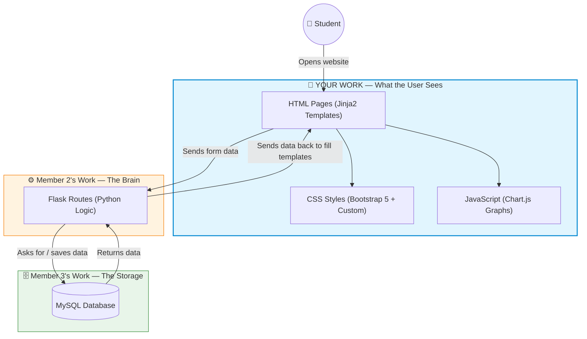
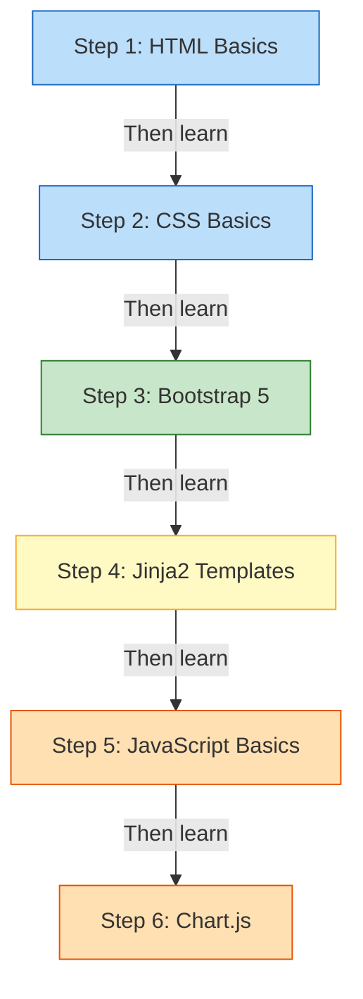
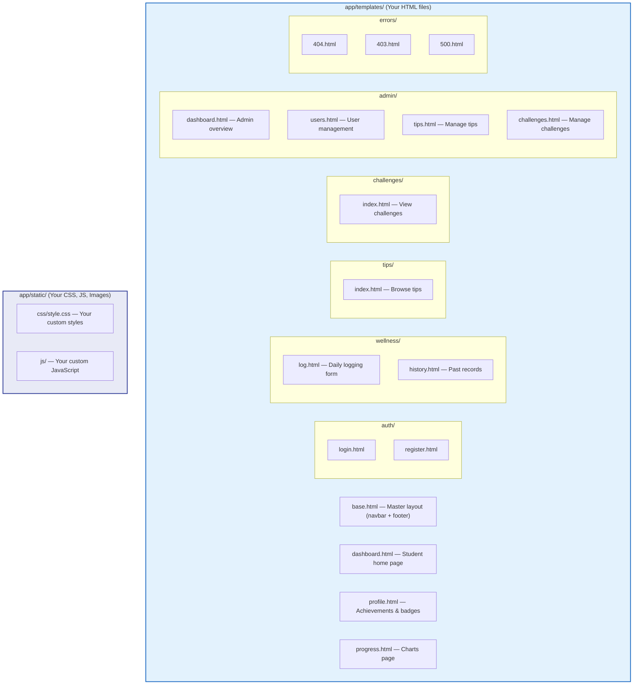

# 🎨 Member 1: Frontend Developer (UI/UX Layer)

**Your Name:** _______________  
**Role:** Frontend Developer — Presentation Layer  
**In Simple Words:** You build everything the user **sees** and **clicks on** in the browser.

---

## 🏠 What Does "Frontend" Mean?

Imagine a restaurant. The **frontend** is the dining area — the menu, the table layout, the decor. Customers only interact with this part. They never go into the kitchen (backend) or the storage room (database). Your job is to make the dining area beautiful, easy to navigate, and inviting.

In our project, when a student opens `http://localhost:5000` in their browser, every pixel they see — the navigation bar, the forms, the charts, the colors — is **your** work.

---

## 🗺️ How the Whole App Works (Big Picture)



---

## 📚 Study Guide — What You Need to Learn

Here is a step-by-step study plan. Follow it in order. Each topic builds on the previous one.



### Step 1: HTML Basics (The Skeleton)
**What is it?** HTML (HyperText Markup Language) is the language that creates the structure of a web page. Every heading, paragraph, image, form, button, and link is made with HTML.

**Key things to learn for this project:**
- **Tags:** `<h1>`, `<p>`, `<div>`, `<span>`, `<a>`, ``, `<ul>`, `<li>`
- **Forms:** `<form>`, `<input>`, `<select>`, `<textarea>`, `<button>` — these are critical because students use forms to log their sleep, water, exercise, etc.
- **Tables:** `<table>`, `<tr>`, `<td>`, `<th>` — used in the admin panel to list students.
- **Semantic Tags:** `<nav>`, `<main>`, `<footer>`, `<header>` — used in our `base.html` file.

**Example from our project** ([`base.html`](file:///c:/Users/anandhu/project/Wellvia/app/templates/base.html)):
```html
<nav class="navbar navbar-expand-lg navbar-dark">
    <a class="navbar-brand" href="/">
        <i class="bi bi-heart-pulse-fill"></i> Wellvia
    </a>
</nav>
```
This creates the top navigation bar with the Wellvia logo.

---

### Step 2: CSS Basics (The Paint)
**What is it?** CSS (Cascading Style Sheets) controls how HTML elements look — colors, fonts, spacing, sizes, backgrounds, animations.

**Key things to learn for this project:**
- **Selectors:** How to target HTML elements (`.class-name`, `#id-name`, `element-name`)
- **Box Model:** `margin`, `padding`, `border` — how spacing works around elements
- **Colors & Fonts:** `color`, `background-color`, `font-family`, `font-size`
- **Flexbox:** `display: flex` — how elements sit side-by-side
- **Media Queries:** `@media (max-width: 768px)` — making pages look good on phones

**Where in our project?** All custom CSS lives in [`app/static/css/style.css`](file:///c:/Users/anandhu/project/Wellvia/app/static/css/style.css).

---

### Step 3: Bootstrap 5 (The Shortcut)
**What is it?** Bootstrap is a free CSS library made by Twitter. Instead of writing hundreds of lines of CSS, you add Bootstrap class names to your HTML and it styles things for you.

**Key things to learn for this project:**
- **Grid System:** `row`, `col-md-4`, `col-lg-8` — arranges content in columns.
- **Cards:** `card`, `card-body`, `card-title` — the boxes you see on the dashboard.
- **Buttons:** `btn btn-primary`, `btn btn-danger` — styled buttons.
- **Alerts:** `alert alert-success`, `alert alert-danger` — the green/red notification bars at the top.
- **Forms:** `form-control`, `form-label`, `form-select` — pre-styled form inputs.
- **Navigation:** `navbar`, `nav-item`, `nav-link`, `dropdown` — the top navigation bar.
- **Icons:** We use `Bootstrap Icons` (e.g., `<i class="bi bi-heart-pulse-fill"></i>`).

**Example from our project** ([`dashboard.html`](file:///c:/Users/anandhu/project/Wellvia/app/templates/dashboard.html)):
```html
<div class="row g-3 mb-4">
    <div class="col-12 col-md-4">
        <div class="stat-card score-card shadow-sm">
            <div class="stat-label">Today's Wellness Score</div>
            <div class="stat-value">{{ today_record.wellness_score }}/100</div>
        </div>
    </div>
</div>
```
This creates a row of 3 equal cards using Bootstrap's grid system.

---

### Step 4: Jinja2 Templates (The Magic Bridge)
**What is it?** Jinja2 is a templating engine used by Flask. It lets you write HTML that contains **placeholders** which the Python backend fills in with real data before sending the page to the browser.

**Key things to learn for this project:**

| Jinja2 Syntax | What It Does | Example from Our Project |
|---|---|---|
| `{{ variable }}` | Prints a variable's value | `Hello, {{ session.get('username') }} 👋` |
| `` | Conditional logic (show/hide content) | `` |
| `` | Loops through a list | `` |
| `` | Inherits from a parent template | Every page starts with this |
| `` | Defines a replaceable section | Used in `base.html` for page body |
| `{{ url_for('student.dashboard') }}` | Generates a URL for a Flask route | Used in all navigation links |

**This is the most critical concept for your role.** Every HTML page in `app/templates/` uses Jinja2. The data you display (like the wellness score, streak, or tips) comes from Member 2's Python code and is injected through these template variables.

---

### Step 5: JavaScript Basics
**What is it?** JavaScript makes pages interactive. In our project, it is primarily used for:
- Powering the Chart.js graphs on the Progress page
- Client-side form validation (checking inputs before submitting)
- Bootstrap components like dropdown menus

**Key things to learn:** Variables (`let`, `const`), Arrays, Objects, Functions, `document.getElementById()`.

---

### Step 6: Chart.js (Drawing Graphs)
**What is it?** Chart.js is a JavaScript library that draws beautiful, interactive charts. You feed it data (labels and numbers) and tell it what chart type to use (line, bar, pie, doughnut).

**Where in our project?** The "My Progress" page ([`progress.html`](file:///c:/Users/anandhu/project/Wellvia/app/templates/progress.html)) uses Chart.js to visualize weekly sleep, water, exercise, mood, stress, and study trends.

```javascript
// Example: Creating a line chart for sleep data
const ctx = document.getElementById('sleepChart').getContext('2d');
new Chart(ctx, {
    type: 'line',
    data: {
        labels: {{ chart_data.labels | tojson }},  // Jinja2 injects dates!
        datasets: [{
            label: 'Sleep (hours)',
            data: {{ chart_data.sleep | tojson }},   // Jinja2 injects numbers!
        }]
    }
});
```
Notice how **Jinja2** (`{{ ... | tojson }}`) is used to pass Python data directly into JavaScript. This is the key connection between your work and Member 2's work.

---

## 📁 Your Files — Complete Map



---

## 🎤 Presentation Guide — What to Explain in Your Viva

When it's your turn to present, here is exactly what you should say and demonstrate:

### 1. "I built the User Interface"
> *"I was responsible for designing and coding all the visual pages that students and admins interact with. I used **HTML5** for structure, **Bootstrap 5** for responsive design, and **custom CSS** for our unique brand colors and card styles."*

### 2. "I used Jinja2 templates for dynamic content"
> *"Our pages are not static — they show real data. I used **Jinja2 template inheritance**: a single `base.html` file contains the navbar and footer shared by every page, and each individual page like `dashboard.html` extends it using `` and fills in its own ``."*

**Show:** Open `base.html` and point to ``, then open `dashboard.html` and show how it extends and fills that block.

### 3. "I implemented the responsive dashboard"
> *"The student dashboard shows 3 stat cards — Wellness Score, Streak, and Points — using Bootstrap's grid (`col-md-4`). On mobile, they stack vertically. I also created the daily tracking summary that displays today's logged sleep, water, exercise, mood, stress, and study data."*

**Show:** The dashboard page. Resize the browser window to show mobile responsiveness.

### 4. "I built the data visualisation with Chart.js"
> *"On the 'My Progress' page, I used the **Chart.js** library to draw interactive line charts. The data is passed from the Python backend as JSON through Jinja2's `tojson` filter. I created charts for sleep trends, hydration, mood, stress, and a doughnut chart for habit completion rates."*

**Show:** The Progress page with interactive charts.

### 5. "I designed the Admin Panel"
> *"I also built the admin dashboard that shows system-wide statistics like total students, average sleep hours, mood distribution (as a pie chart), and challenge completion data. The admin can manage user accounts, wellness tips, and challenges through forms I designed."*

---

## ✅ Summary — Your Contribution Checklist

| What You Built | Where It Lives |
|---|---|
| Master layout (navbar, footer, flash messages) | `app/templates/base.html` |
| Login & Registration forms | `app/templates/auth/login.html`, `register.html` |
| Student Dashboard with stat cards | `app/templates/dashboard.html` |
| Daily Wellness Logging form | `app/templates/wellness/log.html` |
| Wellness History table | `app/templates/wellness/history.html` |
| Wellness Tips browsing page | `app/templates/tips/index.html` |
| Challenges page with completion buttons | `app/templates/challenges/index.html` |
| Profile & Achievements page | `app/templates/profile.html` |
| Interactive Charts (Progress page) | `app/templates/progress.html` |
| Admin Dashboard with analytics charts | `app/templates/admin/dashboard.html` |
| Admin User Management page | `app/templates/admin/users.html` |
| Admin Tips & Challenges management | `app/templates/admin/tips.html`, `challenges.html` |
| Error pages (404, 403, 500) | `app/templates/errors/` |
| All custom styling | `app/static/css/style.css` |
| Client-side JavaScript | `app/static/js/` |
