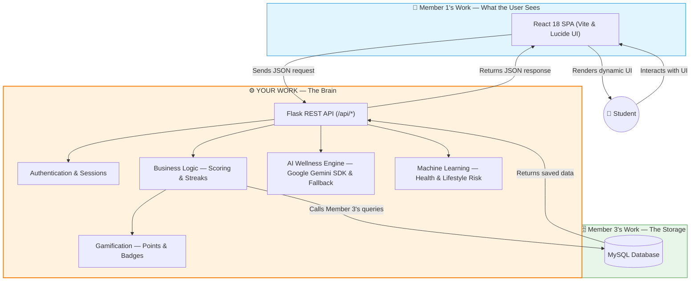
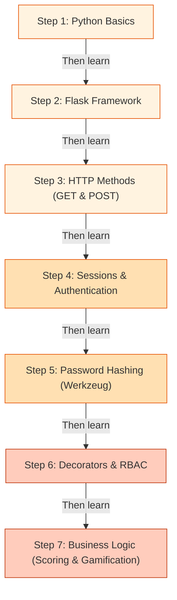
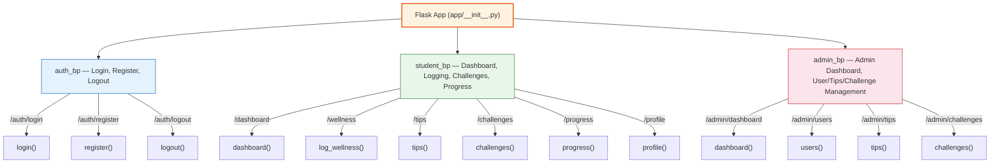
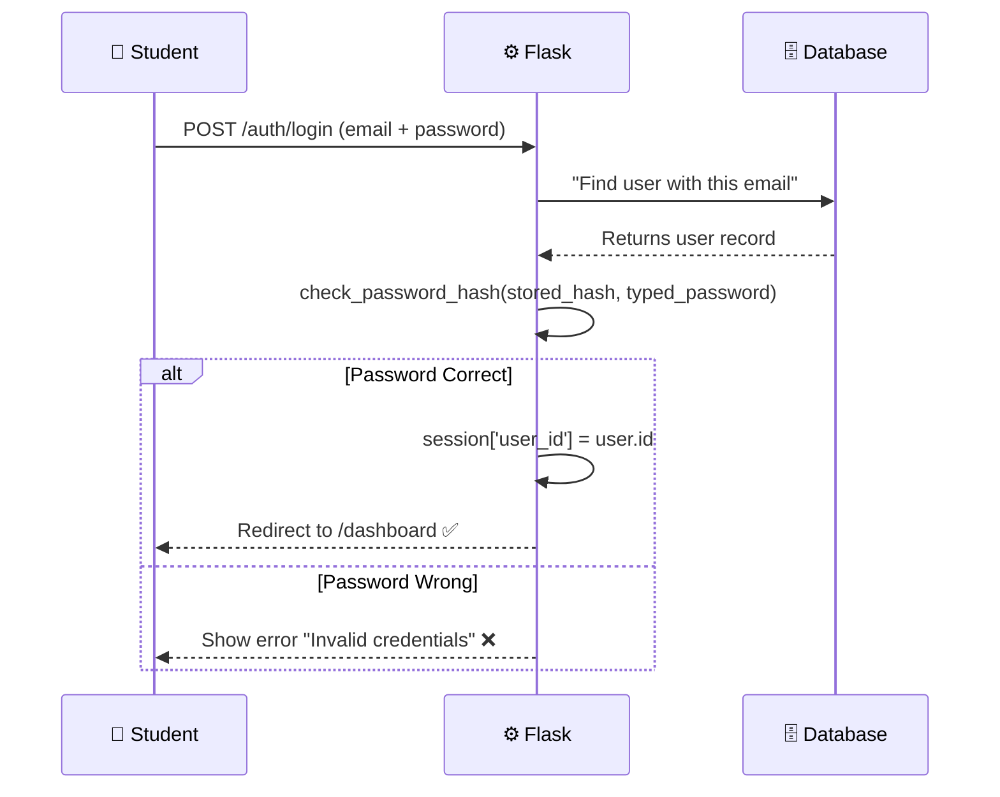
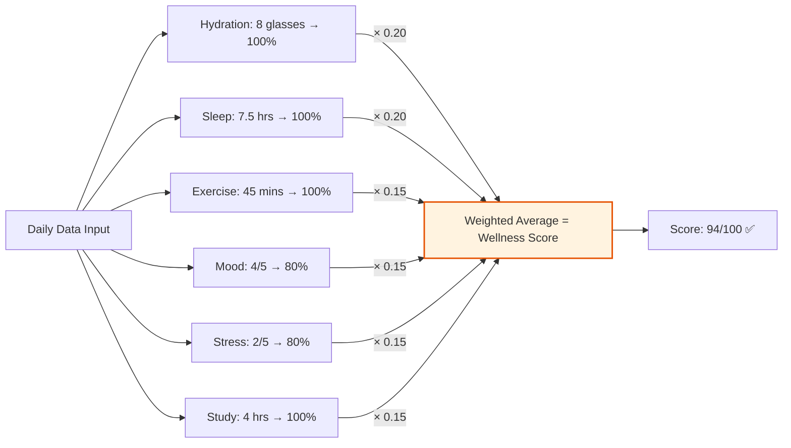
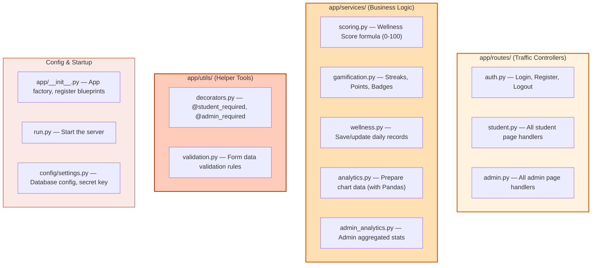

# ⚙️ Member 2: Backend Developer (Application Logic Layer)

**Your Name:** _______________  
**Role:** Backend Developer — Application Logic Layer  
**In Simple Words:** You write the Python code that **processes data**, **enforces rules**, and **connects** the frontend to the database.

---

## 🏠 What Does "Backend" Mean?

Imagine a restaurant again. The **backend** is the kitchen. Customers (users) never see the kitchen, but it is where all the real work happens — the chef receives the order (form data), follows the recipe (business logic), fetches ingredients from the storage room (database), cooks the meal (processes data), and sends the finished dish back out to the dining area (frontend).

In our project, when a student clicks "Save" on the wellness form, the data travels from the browser to **your** Python code. You validate it, calculate the wellness score, award points, and tell the database to store it.

---

## 🗺️ How the Whole App Works (Big Picture)



---

## 📚 Study Guide — What You Need to Learn

Follow this study plan in order. Each topic builds on the previous one.



### Step 1: Python Basics (The Language)
**What is it?** Python is the programming language that powers our entire backend. All the server-side logic is written in Python.

**Key things to learn for this project:**
- **Variables & Data Types:** `str`, `int`, `float`, `dict`, `list`, `None`
- **Functions:** `def my_function(param1, param2):` — you will write many functions.
- **Conditionals:** `if`, `elif`, `else` — used everywhere for decision-making.
- **Dictionaries:** `{'key': 'value'}` — form data and database results come as dictionaries.
- **Error Handling:** `try` / `except` — catching errors so the app doesn't crash.
- **Imports:** `from flask import ...` — how Python files use code from other files.

---

### Step 2: Flask Framework (The Web Engine)
**What is it?** Flask is a lightweight Python web framework. It turns your Python functions into web pages. When someone visits a URL, Flask calls the right Python function and returns the result to the browser.

**Key concept — Routes:**
A "route" is a URL mapped to a Python function. When a user visits `/dashboard`, Flask calls the `dashboard()` function.

**Example from our project** ([`app/routes/student.py`](file:///c:/Users/anandhu/project/Wellvia/app/routes/student.py)):
```python
@student_bp.route('/dashboard')
@student_required
def dashboard():
    user_id = session['user_id']
    user = execute_query("SELECT * FROM users WHERE id = %s", (user_id,), fetchone=True)
    today_record = get_today_record(user_id)
    streak = calculate_current_streak(user_id)
    # ... gather data ...
    return render_template('dashboard.html', user=user, today_record=today_record, streak=streak)
```

**What's happening here (line by line):**
1. `@student_bp.route('/dashboard')` — When someone visits `/dashboard`, run this function.
2. `@student_required` — But first, check they are logged in AND are a student.
3. `session['user_id']` — Get the logged-in user's ID from the session.
4. `execute_query(...)` — Ask the database for the user's data (Member 3's function).
5. `get_today_record(user_id)` — Get today's wellness record.
6. `calculate_current_streak(user_id)` — Calculate how many consecutive days they've logged.
7. `render_template('dashboard.html', ...)` — Send all this data to Member 1's HTML template to display.

**Key concept — Blueprints:**
Our app is organized into 3 blueprints (groups of routes). This keeps the code clean:



---

### Step 3: HTTP Methods — GET vs POST
**What is it?** When a browser talks to your Flask server, it uses "HTTP methods":
- **GET** = "I want to **see** something" (e.g., show me the login page)
- **POST** = "I want to **send** something" (e.g., here is my login form data)

**Example from our project** ([`app/routes/auth.py`](file:///c:/Users/anandhu/project/Wellvia/app/routes/auth.py)):
```python
@auth_bp.route('/login', methods=['GET', 'POST'])
def login():
    if request.method == 'POST':
        # User submitted the login form — process it
        login_input = request.form.get('login_input', '').strip()
        password = request.form.get('password', '')
        # ... validate and log them in ...
    
    # GET request — just show the login page
    return render_template('auth/login.html')
```

**In simple terms:** When the user first visits `/auth/login`, it's a GET request — so we just show them the form. When they fill in the form and click "Login", it becomes a POST request — so we read their email/password and check if they're correct.

---

### Step 4: Sessions & Authentication
**What is it?** A "session" is how the server remembers who is logged in. When a student logs in successfully, we store their info in the session. On every subsequent page, we check the session to know who they are.

**How it works in our project** ([`app/routes/auth.py`](file:///c:/Users/anandhu/project/Wellvia/app/routes/auth.py)):
```python
# After verifying password is correct:
session.clear()
session['user_id'] = user['id']        # Store the user's ID
session['username'] = user['username']  # Store their name
session['email'] = user['email']        # Store their email
session['role'] = user['role']          # Store 'student' or 'admin'
```



---

### Step 5: Password Hashing (Werkzeug Security)
**What is it?** We **never** store passwords in plain text. If someone hacks the database, they would see all passwords! Instead, we use "hashing" — a one-way mathematical function that turns `"mypassword123"` into something like `"pbkdf2:sha256:600000$abc..."`. You cannot reverse this.

**Our project uses Werkzeug** ([`app/routes/auth.py`](file:///c:/Users/anandhu/project/Wellvia/app/routes/auth.py)):
```python
from werkzeug.security import generate_password_hash, check_password_hash

# During Registration — hash the password before saving:
password_hash = generate_password_hash(password)

# During Login — compare typed password against stored hash:
if check_password_hash(user['password_hash'], password):
    # Password is correct!
```

---

### Step 6: Decorators & Role-Based Access Control (RBAC)
**What is it?** A "decorator" is a special Python function that wraps around another function to add extra checks. We use decorators to protect routes.

**Our project has 3 decorators** ([`app/utils/decorators.py`](file:///c:/Users/anandhu/project/Wellvia/app/utils/decorators.py)):

| Decorator | What It Does | Used On |
|---|---|---|
| `@login_required` | Checks if user is logged in. If not, redirects to login page. | General protected pages |
| `@student_required` | Checks if user is logged in AND has role `'student'`. | All student pages (dashboard, wellness, etc.) |
| `@admin_required` | Checks if user is logged in AND has role `'admin'`. | All admin pages (admin dashboard, user management, etc.) |

**Example:**
```python
@student_bp.route('/dashboard')
@student_required          # <-- This decorator runs FIRST
def dashboard():           # <-- This function runs ONLY if the decorator allows it
    ...
```
If a non-logged-in user tries to visit `/dashboard`, the decorator catches them and sends them to the login page.

---

### Step 7: Business Logic — Scoring & Gamification
**What is it?** This is the "brain" of the app — the rules and formulas that make the app interesting. You wrote the logic for:

**A) Wellness Score Calculation** ([`app/services/scoring.py`](file:///c:/Users/anandhu/project/Wellvia/app/services/scoring.py)):
The wellness score is a number from 0 to 100, calculated from 6 categories:

| Category | Weight | Target for 100% Score |
|---|---|---|
| Hydration | 20% | 8+ glasses of water |
| Sleep | 20% | 7–9 hours |
| Exercise | 15% | 30+ minutes |
| Mood | 15% | Rating 5/5 |
| Stress | 15% | Rating 1/5 (low stress = good) |
| Study Balance | 15% | 2–6 hours (not too little, not too much) |



**B) Streak Calculation** ([`app/services/gamification.py`](file:///c:/Users/anandhu/project/Wellvia/app/services/gamification.py)):
A streak counts how many consecutive days a student has logged wellness data.
```
Day 1: Logged ✅  →  Streak: 1
Day 2: Logged ✅  →  Streak: 2
Day 3: Logged ✅  →  Streak: 3
Day 4: Missed ❌  →  Streak: 0 (resets!)
Day 5: Logged ✅  →  Streak: 1
```

**C) Achievements & Badges** ([`app/services/gamification.py`](file:///c:/Users/anandhu/project/Wellvia/app/services/gamification.py)):
After every wellness log, the system checks if the student has earned any new badges:
- 🔥 "3-Day Streak" — Log 3 days in a row
- 💧 "Hydration Hero" — Hit 8 glasses target 5 times
- 🏃 "Active Lifestyle" — Exercise 20+ minutes on 5 days
- 🏆 "Challenge Champion" — Complete 5 challenges

**D) Points System** ([`app/services/gamification.py`](file:///c:/Users/anandhu/project/Wellvia/app/services/gamification.py)):
- Daily wellness log = **+10 points**
- Complete a daily challenge = **+20 points**
- Complete a weekly challenge = **+50 points**

---

## 📁 Your Files — Complete Map



---

## 🎤 Presentation Guide — What to Explain in Your Viva

### 1. "I built the Flask application and its routing"
> *"I set up the Flask application using the **Factory Pattern** in `app/__init__.py`. The app is organized into 3 **Blueprints**: `auth` for login/register, `student` for all student features, and `admin` for the administration panel. Each Blueprint groups related URLs together."*

**Show:** Open `app/__init__.py` and point to the blueprint registration. Then open `app/routes/student.py` and show a route.

### 2. "I implemented secure authentication"
> *"I implemented user registration and login. Passwords are **never stored in plain text** — they are hashed using **Werkzeug's `generate_password_hash`** function (which uses PBKDF2-SHA256). During login, I use `check_password_hash` to verify the password. User sessions are managed using Flask's built-in session system."*

**Show:** Open `app/routes/auth.py`, show the `register()` and `login()` functions.

### 3. "I enforced Role-Based Access Control (RBAC)"
> *"I wrote custom **decorators** — `@student_required` and `@admin_required` — that protect routes. If a student tries to access an admin page, they get a **403 Forbidden** error. This ensures students can only see student pages and admins can only see admin pages."*

**Show:** Open `app/utils/decorators.py` and walk through the logic.

### 4. "I designed the Wellness Score algorithm"
> *"I created a **rule-based wellness score engine** that calculates a score from 0 to 100. It takes 6 inputs (sleep, hydration, exercise, mood, stress, study hours), normalizes each to a 0-100 scale, applies weighted averages (sleep and hydration are weighted higher at 20% each), and produces a single composite score. If some data is missing, the weights are dynamically redistributed."*

**Show:** Open `app/services/scoring.py` and walk through the `calculate_wellness_score()` function.

### 5. "I built the gamification engine"
> *"To keep students motivated, I built a gamification system with **Points** (+10 per log, +20 per challenge), **Streaks** (counting consecutive days), and **Achievement Badges**. After every wellness log, the system automatically checks if the student qualifies for any new badges."*

**Show:** Open `app/services/gamification.py` and walk through `calculate_current_streak()` and `check_and_award_achievements()`.

### 6. "I handled form validation"
> *"I wrote server-side validation in `app/utils/validation.py` to ensure data integrity. For example, sleep hours must be between 0 and 24, water glasses between 0 and 30, and mood/stress ratings between 1 and 5. Registration checks for valid email format and minimum password length."*

---

## ✅ Summary — Your Contribution Checklist

| What You Built | Where It Lives |
|---|---|
| Flask app factory & Blueprint registration | `app/__init__.py` |
| Login, Register, Logout logic | `app/routes/auth.py` |
| Student dashboard, wellness logging, tips, challenges, progress, profile routes | `app/routes/student.py` |
| Admin dashboard, user management, tips management, challenges management | `app/routes/admin.py` |
| Wellness Score algorithm (0–100 weighted formula) | `app/services/scoring.py` |
| Streak calculation (consecutive days) | `app/services/gamification.py` |
| Points system (+10, +20, +50) | `app/services/gamification.py` |
| Achievement badge checking & awarding | `app/services/gamification.py` |
| Save/Update daily wellness records & trigger gamification | `app/services/wellness.py` |
| Student analytics data preparation (with Pandas) | `app/services/analytics.py` |
| Admin aggregated analytics (with Pandas) | `app/services/admin_analytics.py` |
| `@student_required` and `@admin_required` decorators | `app/utils/decorators.py` |
| Registration & wellness input validation | `app/utils/validation.py` |
| App configuration (secret key, DB settings, session config) | `config/settings.py` |
| Application entry point | `run.py` |
