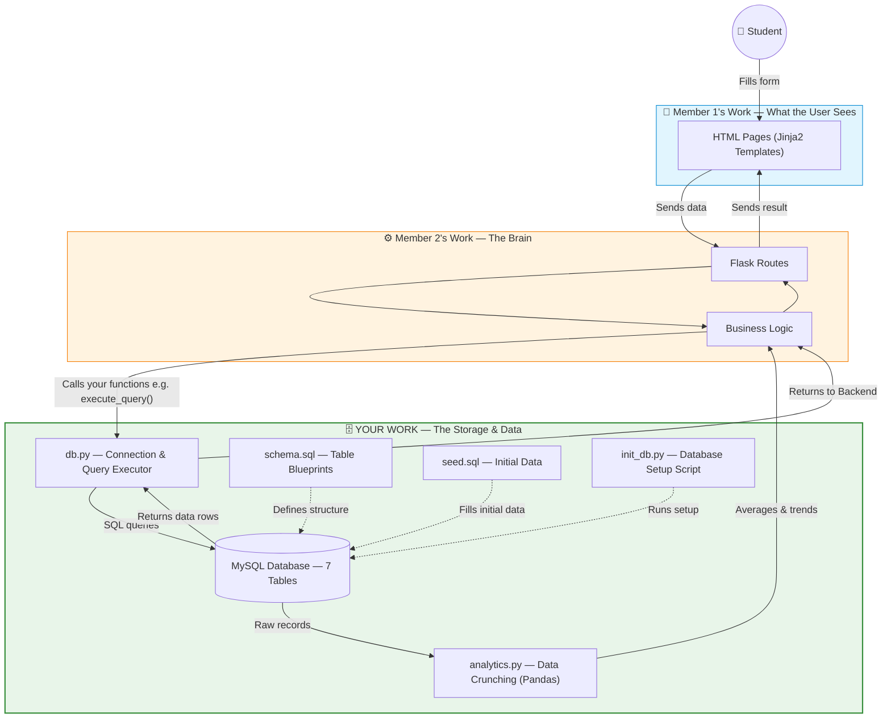
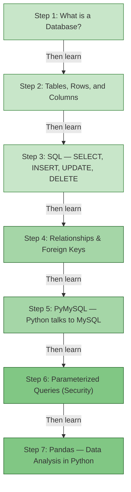
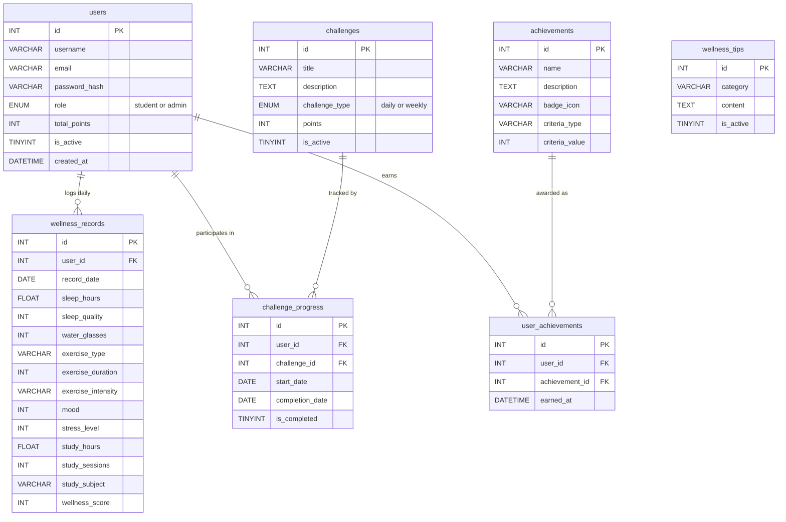
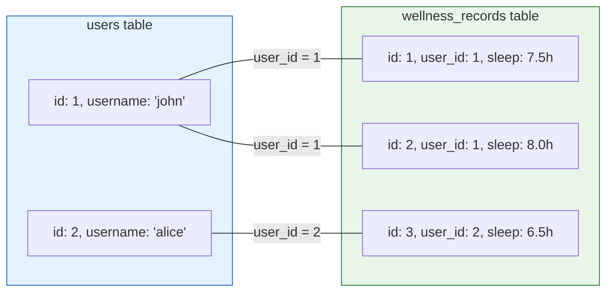
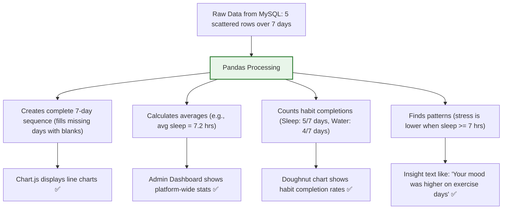
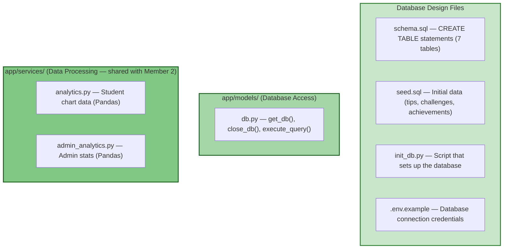

# 🗄️ Member 3: Database & Analytics Developer (Data Layer)

**Your Name:** _______________  
**Role:** Database & Analytics Developer — Data Access Layer  
**In Simple Words:** You design the **storage system**, write the code that **saves and retrieves data**, and **crunch numbers** for analytics dashboards.

---

## 🏠 What Does "Database" Mean?

Imagine a restaurant one more time. The **database** is the storage room and filing cabinet. Every order placed, every ingredient used, and every customer record is stored here. Without the storage room, the kitchen (backend) has nothing to cook with and no way to remember anything.

In our project, every student account, every daily wellness log, every tip, every challenge, and every badge is stored in the MySQL database. When a student logs 8 glasses of water, **your** code saves it. When the dashboard needs to display their streak, **your** code retrieves it.

---

## 🗺️ How the Whole App Works (Big Picture)



---

## 📚 Study Guide — What You Need to Learn

Follow this study plan in order. Each topic builds on the previous one.



### Step 1: What is a Database?
**What is it?** A database is a structured, organized system for storing data permanently. Think of it as a collection of **Excel spreadsheets** stored on a server. Each spreadsheet is a "table". Even if the computer restarts, the data stays.

**Our project uses MySQL** — one of the most popular relational databases in the world. The word "relational" means the tables can **relate to each other** (e.g., a user has many wellness records).

---

### Step 2: Tables, Rows, and Columns
**What is it?** A database table has:
- **Columns** (fields) — define *what* data is stored (e.g., `username`, `email`, `sleep_hours`)
- **Rows** (records) — each row is one entry (e.g., one student, one day's wellness log)
- **Primary Key** — a unique ID for every row (e.g., `id = 1`, `id = 2`)

**Our project has 7 tables.** Here is the complete database structure:



**What each table stores:**

| Table | What It Stores | Example Data |
|---|---|---|
| `users` | Student and admin accounts | `id=1, username='john', role='student', total_points=150` |
| `wellness_records` | One row per student per day with all health data | `user_id=1, record_date='2026-09-07', sleep_hours=7.5, water_glasses=8, mood=4` |
| `wellness_tips` | Health tips created by admins | `category='Sleep', content='Try reading a book before bed'` |
| `challenges` | Goals created by admins | `title='Drink 8 Glasses Today', points=20, challenge_type='daily'` |
| `challenge_progress` | Tracks which student completed which challenge on which day | `user_id=1, challenge_id=3, is_completed=1` |
| `achievements` | Badge definitions (what achievements exist) | `name='3-Day Streak', criteria_type='streak', criteria_value=3` |
| `user_achievements` | Junction table: which student earned which badge | `user_id=1, achievement_id=2, earned_at='2026-09-07'` |

---

### Step 3: SQL — The Database Language
**What is it?** SQL (Structured Query Language) is the language you use to "talk" to MySQL. It has 4 main operations called **CRUD**:

| Operation | SQL Command | What It Does | Example from Our Project |
|---|---|---|---|
| **C**reate | `INSERT INTO` | Adds a new row | `INSERT INTO users (username, email, password_hash) VALUES ('john', 'john@test.com', 'hashed...')` |
| **R**ead | `SELECT` | Retrieves data | `SELECT * FROM users WHERE id = 1` |
| **U**pdate | `UPDATE` | Modifies existing data | `UPDATE users SET total_points = total_points + 10 WHERE id = 1` |
| **D**elete | `DELETE` | Removes a row | `DELETE FROM wellness_tips WHERE id = 5` |

**Important SQL keywords for this project:**
- `WHERE` — filter rows: `WHERE role = 'student'`
- `ORDER BY` — sort results: `ORDER BY record_date DESC`
- `JOIN` — combine tables: `LEFT JOIN challenge_progress cp ON c.id = cp.challenge_id`
- `COUNT(*)` — count rows: `SELECT COUNT(*) FROM users`
- `SUM()`, `AVG()` — add up or average values
- `GROUP BY` — group rows for aggregation
- `UNIQUE` — prevents duplicate entries
- `FOREIGN KEY` — links a column in one table to another table's primary key

**Real example from our project** ([`app/routes/admin.py`](file:///c:/Users/anandhu/project/Wellvia/app/routes/admin.py)):
```sql
-- This query gets all students with their total log count
SELECT u.id, u.username, u.email, u.total_points, u.is_active, u.created_at,
       COUNT(r.id) as log_count
FROM users u
LEFT JOIN wellness_records r ON u.id = r.user_id
WHERE u.role = 'student'
GROUP BY u.id
ORDER BY u.created_at DESC
```

**Line-by-line explanation:**
1. `SELECT ...` — Pick these columns from the result
2. `COUNT(r.id) as log_count` — Count how many wellness records each student has
3. `FROM users u` — Start from the users table (nicknamed `u`)
4. `LEFT JOIN wellness_records r ON u.id = r.user_id` — Attach matching wellness records
5. `WHERE u.role = 'student'` — Only include students, not admins
6. `GROUP BY u.id` — Group results by each unique student
7. `ORDER BY u.created_at DESC` — Newest students first

---

### Step 4: Relationships & Foreign Keys
**What is it?** In a relational database, tables are connected through **foreign keys**. A foreign key is a column in one table that points to the primary key of another table.



**Our schema** ([`schema.sql`](file:///c:/Users/anandhu/project/Wellvia/schema.sql)) defines:
- `wellness_records.user_id` → references `users.id`
- `challenge_progress.user_id` → references `users.id`
- `challenge_progress.challenge_id` → references `challenges.id`
- `user_achievements.user_id` → references `users.id`
- `user_achievements.achievement_id` → references `achievements.id`

The `ON DELETE CASCADE` rule means: if a user is deleted, all their wellness records, challenge progress, and achievements are automatically deleted too.

---

### Step 5: PyMySQL — Python Talks to MySQL
**What is it?** PyMySQL is a Python library that lets Python code connect to a MySQL server and execute SQL queries.

**How our project uses it** ([`app/models/db.py`](file:///c:/Users/anandhu/project/Wellvia/app/models/db.py)):
```python
import pymysql

# Create a connection to the MySQL database
connection = pymysql.connect(
    host='localhost',
    port=3306,
    user='root',
    password='',
    database='wellness_db',
    cursorclass=pymysql.cursors.DictCursor  # Returns rows as dictionaries!
)
```

The `DictCursor` is important — it means results come back as Python dictionaries:
```python
# Without DictCursor: (1, 'john', 'john@test.com')    — hard to use!
# With DictCursor:    {'id': 1, 'username': 'john', 'email': 'john@test.com'}  — easy!
```

**The `execute_query()` function** is the central function that all of Member 2's code calls. It handles:
- Connecting to the database
- Running the SQL query
- Returning results (`fetchone` for one row, `fetchall` for multiple rows)
- Saving changes (`commit=True` for INSERT/UPDATE/DELETE)
- Error handling and automatic rollback if something goes wrong
- **Dual database support** — tries MySQL first, falls back to SQLite if MySQL is unavailable

---

### Step 6: Parameterized Queries (Security!)
**What is it?** This is one of the most important security concepts in web development. A **parameterized query** uses placeholders (`%s`) instead of putting user input directly into SQL.

**Why?** To prevent **SQL Injection** — a hacking technique where an attacker types malicious SQL into a form field.

```python
# ❌ DANGEROUS — Never do this!
query = f"SELECT * FROM users WHERE username = '{user_input}'"
# If user_input = "admin' OR '1'='1", this becomes:
# SELECT * FROM users WHERE username = 'admin' OR '1'='1'  (returns ALL users!)

# ✅ SAFE — Our project does this (using %s placeholders)
query = "SELECT * FROM users WHERE username = %s"
execute_query(query, (user_input,), fetchone=True)
# PyMySQL safely escapes the input, preventing injection.
```

**Every single SQL query in our project uses parameterized queries.** This is a critical security feature you should highlight in your presentation.

---

### Step 7: Pandas — Data Analysis in Python
**What is it?** Pandas is a powerful Python library for data analysis. Think of it as "Excel inside Python". It lets you load data into a table (called a "DataFrame"), filter it, calculate averages, and group it.

**How our project uses it** ([`app/services/analytics.py`](file:///c:/Users/anandhu/project/Wellvia/app/services/analytics.py)):

```python
import pandas as pd

# 1. Get raw records from database
records = execute_query("SELECT record_date, sleep_hours, ... FROM wellness_records ...", ...)

# 2. Load into a Pandas DataFrame (like an Excel sheet in Python)
df = pd.DataFrame(records)

# 3. Create a complete date range (so missing days show as blanks on the chart)
date_range = pd.date_range(start=start_date, end=end_date)

# 4. Merge — fill in gaps with None for dates with no data
df = pd.merge(df_dates, df_records, on='record_date', how='left')

# 5. Calculate averages
avg_stress_good_sleep = df[df['sleep_hours'] >= 7]['stress_level'].mean()
```

**What Pandas does in our project:**



**Example: Admin Analytics** ([`app/services/admin_analytics.py`](file:///c:/Users/anandhu/project/Wellvia/app/services/admin_analytics.py)):
```python
# Calculate mood distribution for a pie chart
mood_counts = df['mood'].value_counts().to_dict()
mood_dist = [
    mood_counts.get(5, 0),  # Very Happy
    mood_counts.get(4, 0),  # Happy
    mood_counts.get(3, 0),  # Neutral
    mood_counts.get(2, 0),  # Sad
    mood_counts.get(1, 0)   # Very Sad
]
# This produces [12, 25, 18, 5, 2] — ready for Chart.js pie chart!
```

---

## 📁 Your Files — Complete Map



### Detailed File Breakdown

**1. [`schema.sql`](file:///c:/Users/anandhu/project/Wellvia/schema.sql) — The Database Blueprint**
- Creates the `wellness_db` database
- Defines all 7 tables with column names, data types, constraints
- Sets up indexes for faster queries
- Establishes foreign key relationships and cascade deletes

**2. [`seed.sql`](file:///c:/Users/anandhu/project/Wellvia/seed.sql) — Initial Data**
- Inserts starter wellness tips into the `wellness_tips` table
- Inserts starter challenges into the `challenges` table
- Inserts achievement badge definitions into the `achievements` table
- Creates a default admin account

**3. [`init_db.py`](file:///c:/Users/anandhu/project/Wellvia/init_db.py) — Setup Script**
- Connects to MySQL using credentials from `.env`
- Runs the schema SQL to create tables
- Seeds initial data (tips, challenges, achievements, admin user)
- Also supports SQLite as a fallback database

**4. [`app/models/db.py`](file:///c:/Users/anandhu/project/Wellvia/app/models/db.py) — The Heart of Your Work**
- `get_db()` — Creates or retrieves the database connection
- `close_db()` — Closes the connection when a request ends
- `execute_query()` — The universal function everyone uses to run SQL:
  - `execute_query("SELECT ...", fetchone=True)` → Returns one dictionary
  - `execute_query("SELECT ...", fetchall=True)` → Returns a list of dictionaries
  - `execute_query("INSERT ...", commit=True)` → Saves data and returns the new row's ID

**5. [`app/services/analytics.py`](file:///c:/Users/anandhu/project/Wellvia/app/services/analytics.py) — Student Charts**
- Fetches wellness records for the last 7/30 days
- Uses Pandas to create a continuous date range (filling gaps)
- Produces JSON-ready data for Chart.js (sleep, water, exercise, mood, stress, study, score series)
- Calculates habit completion rates for a doughnut chart
- Generates text insights (e.g., "stress was lower on good sleep days")

**6. [`app/services/admin_analytics.py`](file:///c:/Users/anandhu/project/Wellvia/app/services/admin_analytics.py) — Admin Dashboard Data**
- Counts total and active students
- Calculates platform-wide averages (avg sleep, avg water, avg study, avg wellness score)
- Creates mood distribution and stress distribution arrays for pie charts
- Aggregates challenge completion counts
- **All data is anonymized — no individual student data is exposed.**

---

## 🎤 Presentation Guide — What to Explain in Your Viva

### 1. "I designed the database schema"
> *"I designed the MySQL database with **7 normalized tables**. The central table is `wellness_records`, which stores one row per student per day with all 12 health metrics. Tables are connected using **foreign keys** — for example, `wellness_records.user_id` references `users.id`. I also used `ON DELETE CASCADE` so that if a user is deleted, all their related records are automatically removed."*

**Show:** Open `schema.sql` and walk through the `CREATE TABLE` statements. Point to the `FOREIGN KEY` and `UNIQUE KEY` lines.

### 2. "I built the database access layer"
> *"I wrote the `execute_query()` function in `app/models/db.py`, which is the single function that all other parts of the application use to interact with the database. It supports reading one row, reading multiple rows, and writing data. It also uses **parameterized queries** with `%s` placeholders to prevent **SQL injection attacks**."*

**Show:** Open `app/models/db.py` and walk through `execute_query()`. Show the `%s` placeholders.

### 3. "I ensured data security"
> *"Every SQL query in the project uses **parameterized queries** instead of string formatting. This prevents SQL injection, one of the most common web vulnerabilities. I also implemented `ON DELETE CASCADE` for referential integrity, `UNIQUE` constraints to prevent duplicate records, and connection teardown to prevent resource leaks."*

**Show:** Open any route file and point to how `execute_query()` is called with `%s` parameters.

### 4. "I built the analytics engine using Pandas"
> *"I used the **Pandas** library to process raw database records into meaningful statistics. For student charts, I create a continuous 7-day or 30-day date range and merge it with actual records, filling gaps with `None` so that Chart.js shows blank spaces for missed days. For the admin dashboard, I calculate platform-wide averages and distributions — all completely **anonymized** with no individual student data exposed."*

**Show:** Open `app/services/analytics.py` and walk through the Pandas operations. Then open `app/services/admin_analytics.py` and show the mood/stress distribution calculation.

### 5. "I generated pattern-based insights"
> *"The analytics engine doesn't just show raw data — it generates **text-based insights**. For example, it compares average stress levels on days with 7+ hours of sleep vs. days with less sleep. If there's a meaningful difference, it shows: *'Your stress level was lower on days when you logged at least 7 hours of sleep.'* These are pattern-based observations, not clinical assessments."*

**Show:** Open `app/services/analytics.py` and point to the insights generation code at the bottom.

### 6. "I set up the database initialization pipeline"
> *"I wrote `init_db.py` which automates the entire database setup. It connects to MySQL, creates all 7 tables from `schema.sql`, seeds initial data (10 wellness tips, 5 challenges, 8 achievement badges, and 1 admin account), and hashes the admin password securely. The project also supports SQLite as a fallback."*

**Show:** Run `python init_db.py` in the terminal and explain the output.

---

## ✅ Summary — Your Contribution Checklist

| What You Built | Where It Lives |
|---|---|
| MySQL database schema (7 tables, foreign keys, indexes, constraints) | `schema.sql` |
| Initial seed data (tips, challenges, achievements, admin user) | `seed.sql` |
| Database initialization script (auto-setup) | `init_db.py` |
| Database connection management (connect, close, context-bound) | `app/models/db.py` |
| Universal `execute_query()` function (parameterized, safe) | `app/models/db.py` |
| Dual-database support (MySQL primary + SQLite fallback) | `app/models/db.py` |
| Student analytics: date-range processing, chart data, habit completion rates | `app/services/analytics.py` |
| Student analytics: pattern-based text insights | `app/services/analytics.py` |
| Admin analytics: platform-wide averages, mood/stress distributions | `app/services/admin_analytics.py` |
| Admin analytics: challenge completion aggregation | `app/services/admin_analytics.py` |
| Environment variable configuration for database credentials | `.env.example` |
